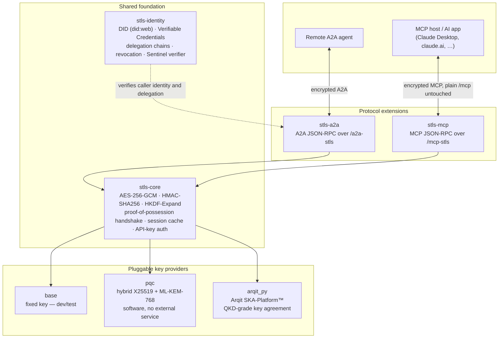

# STLS-AI

**Symmetric Transport Layer Security for AI agents.** Quantum-safe,
application-layer encryption for Agent-to-Agent (A2A) and Model Context
Protocol (MCP) traffic, plus a DID/Verifiable-Credential identity layer
to go with it — in Python and Node.js, byte-for-byte interoperable.

[](LICENSE)
[](LICENSE-COMMERCIAL.md)
[](python)
[](node)

---

## Why STLS exists

TLS protects a connection. It does not protect a message once that
connection terminates — at a load balancer, an ingress proxy, a service
mesh sidecar, or anywhere else traffic is decrypted and re-encrypted on
its way to an AI agent, an MCP tool server, or a hosted model. Agent
traffic increasingly crosses exactly those boundaries: A2A calls between
agents run by different organizations, MCP calls from an agent to a tool
server it does not operate, requests relayed through brokers and
gateways.

STLS adds a second, **application-layer** encrypted channel on top of
whatever transport is already there. The session key never crosses the
wire — client and server each derive it independently from a shared key
provider and prove possession of it via an HMAC challenge-response — and
that key material can itself come from a quantum-safe source: a
software hybrid (X25519 + ML-KEM-768, NIST FIPS 203) with no external
dependency, or real QKD-derived keys via Arqit's SKA-Platform™. The
protocol surface (A2A, MCP) is untouched: a plain client still sees a
spec-compliant A2A or MCP endpoint; the encrypted endpoint sits
alongside it, not instead of it.

## Architecture



Every box above exists twice: once in Python (the reference
implementation) and, for `stls-core` and `stls-mcp`, again in Node.js —
verified against each other with real cross-language tests, not just
"should be compatible" (`node/stls-core`, `node/stls-mcp`).
`stls-identity` and `stls-a2a` are Python-only today.

## Repository layout

```
stls-ai/
├── python/
│   ├── stls-core/        # crypto, handshake, session cache, key providers, API-key auth
│   ├── stls-identity/     # DID + Verifiable Credential identity layer
│   ├── stls-a2a/          # A2A protocol extension (Google ADK, LangChain, Semantic Kernel, custom)
│   └── stls-mcp/          # MCP protocol extension (official MCP SDK, zero modifications)
├── node/
│   ├── stls-core/         # TypeScript port of python/stls-core
│   └── stls-mcp/          # TypeScript port of python/stls-mcp
└── samples/
    ├── client/             # example A2A/MCP clients (plain SDK, secure React chat client)
    └── server/             # example agent servers across frameworks and providers
```

## Packages

| Package | Language | Version | What it provides |
|---|---|---|---|
| [`stls-core`](python/stls-core) | Python ≥3.12 | 0.1.2 | Protocol-agnostic crypto, session cache, handshake, key providers, API-key auth. The common foundation. |
| [`stls-identity`](python/stls-identity) | Python ≥3.12 | 0.1.0 | DID documents, Identity/Operational Verifiable Credentials, delegation, revocation, Trust Anchor Registry, Sentinel verifier. |
| [`stls-a2a`](python/stls-a2a) | Python ≥3.12 | 0.1.5 | Secure A2A transport, framework adapters (Google ADK, LangChain, Semantic Kernel, custom), task lifecycle, agent cards, agent registry. |
| [`stls-mcp`](python/stls-mcp) | Python ≥3.12 | 0.1.2 | Encrypted MCP endpoint (`/mcp-stls`) alongside a 100%-standard MCP endpoint (`/mcp`), built on the official MCP SDK. |
| [`stls-core`](node/stls-core) | Node.js ≥20 / TS | 0.1.2 | TypeScript port of `python/stls-core` — bit-compatible wire format, cross-language tested. |
| [`stls-mcp`](node/stls-mcp) | Node.js ≥20 / TS | 0.1.2 | TypeScript port of `python/stls-mcp` — same dual-endpoint design, verified against the Python server/client. |

Each package README documents its own installation, configuration, and
internals in depth — this document stays at the level of the whole
system.

## Key features

- **Proof-of-possession handshake** — the session key is never
  transmitted; client and server each derive it from a shared key
  provider and prove possession via an HMAC challenge on a random
  nonce (`/stls/handshake`, `/stls/pqc/handshake`).
- **Quantum-safe key providers**, interchangeable behind one interface:
  `base` (fixed key, dev/test), `pqc` (hybrid X25519 + ML-KEM-768,
  software-only, redistributable), `arqit_py` (Arqit SKA-Platform™,
  real QKD-grade key exchange).
- **Authenticated encryption**: AES-256-GCM, a full HMAC-SHA256 over the
  envelope, and HKDF-Expand domain separation between AES and HMAC key
  material.
- **"Absolutely standard on plain"**: in `stls-mcp`, the plaintext
  `/mcp` endpoint is generated by the official SDK, unmodified — a
  spec-compliant client never knows `/mcp-stls` exists.
- **DID + Verifiable Credential identity** (`stls-identity`): agents get
  a persistent, third-party-verifiable identity — separate from
  authorization — with delegation chains, revocation, and a Trust
  Anchor Registry, built on real RFC 8785 (JCS) canonicalization and
  Ed25519 signatures.
- **Pluggable auth**: from a static, timing-safe `AuthConfig` for small
  deployments to a full `ApiKeyManager` with static/file/Postgres
  loaders, Redis-backed caching, and revocation.
- **Framework adapters** for Google ADK, LangChain, Semantic Kernel, and
  custom agents, with automatically generated agent cards.
- **Verified cross-language interoperability**: Python ⇄ Node.js share
  the exact wire format, checked with real round-trip tests, not just
  reviewed for parity.

## Getting started

Each package is installed and configured independently — see its own
README for the full story:

```bash
# Python, e.g. stls-core
cd python/stls-core && uv venv && source .venv/bin/activate && uv pip install -e ".[dev]"

# Node.js, e.g. stls-core
cd node/stls-core && npm install && npm run build
```

`stls-a2a` and `stls-mcp` (both languages) depend on their sibling
`stls-core` as a local monorepo path today; see each package's README
for the exact dependency wiring and environment variables.

## Samples

[`samples/`](samples) holds example clients and servers exercising the
packages above against real agent frameworks and deployment targets:

- [`samples/client/a2a_sdk`](samples/client/a2a_sdk) — plain A2A SDK client.
- [`samples/client/sofia-client-secure`](samples/client/sofia-client-secure) — React + TypeScript chat client routed through a secure transport proxy.
- [`samples/server/2_sk_financial_agent`](samples/server/2_sk_financial_agent) — Semantic Kernel financial agent.
- [`samples/server/5_adk_doc_gen`](samples/server/5_adk_doc_gen) — Google ADK document-generation agent.
- [`samples/server/sofia-admin`](samples/server/sofia-admin) — admin/management server with cloud deployment scaffolding.
- `samples/server/server1`, `server3`, `server4`, `server6`–`server9` — smaller example servers exercising different framework and key-provider combinations.

Samples are for demonstration and are **not** covered by the dual
licensing described below — see [Licensing](#licensing).

## Licensing

STLS-AI is **dual-licensed**:

- **[GNU Affero General Public License v3.0 (AGPLv3)](LICENSE)** — free
  and open source. Use, study, modify, and redistribute it under the
  AGPLv3's terms, including its network-use copyleft (§13): if you run a
  modified version to provide a service over a network, you must offer
  its complete source to your users.
- **[Commercial license](LICENSE-COMMERCIAL.md)** — for embedding STLS
  in closed-source or proprietary products, or distributing it as part
  of a commercial SaaS offering, without the AGPLv3's source-disclosure
  obligations. Contact **ettore.pulieri@tisparkle.com**.

This applies to the six packages under `python/` and `node/` listed
above, each carrying its own `LICENSE` and `LICENSE-COMMERCIAL.md`.
`samples/` is excluded from this grant (see above). Vendored Arqit
SKA-Platform™ wheels (`*/arqit_wheels/`) remain under Arqit's own
proprietary license, unaffected by the above — for commercial
inquiries about the Arqit SKA-Platform™, reach out to the same
contact, **ettore.pulieri@tisparkle.com**.

Copyright (C) 2026 Sparkle SpA.
