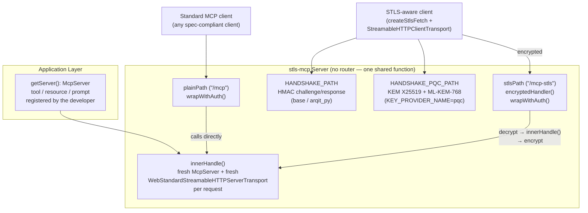

# stls-mcp (Node.js)

TypeScript port of [`python/stls-mcp`](../../python/stls-mcp/README.md) —
the STLS (Symmetric Transport Layer Security) extension of the Model
Context Protocol: application-layer symmetric encryption
(AES-256-GCM + HMAC-SHA256 + HKDF-Expand) on a second Streamable HTTP
endpoint, alongside a **100% standard** MCP endpoint generated and managed
entirely by the official SDK. Built on
[`stls-core`](../stls-core/README.md) (Node.js), which supplies the
crypto, handshake, session cache, key providers and auth it shares with
`stls-a2a`.

Every compatibility claim in this README has been verified with a real
cross-language test (see [Testing](#testing)), not just written on faith:
Node and Python exchange real MCP sessions over the same wire protocol and
produce the exact same tool/resource/prompt results.

## Why it exists

The same reasoning as `python/stls-mcp`: an AI agent using MCP to talk to
external tools should be able to do so over a quantum-safe channel. The
MCP SDK ecosystem is itself TypeScript-first, so a Node server or client
speaking STLS is a direct, practical need — not a hypothetical one.

## Porting status

| Python module | Node | Status | Verified with |
|---|---|---|---|
| `stls_mcp_constants.py` | `src/constants.ts` | ✅ | — |
| `stls_mcp_transport.py` | `src/transport.ts` | ✅ | real cross-language MCP sessions (base + PQC) |
| `stls_mcp_middleware.py` | `src/middleware.ts` | ✅ | real cross-language MCP sessions |
| `stls_mcp_server.py` | `src/server.ts` | ✅ | real cross-language MCP sessions, official unmodified client against the plain path |
| `stls_mcp_auth.py` | `src/auth.ts` | ✅ | reuses `ApiKeyManager`/`AuthConfig` already verified in `stls-core` |
| `stls_mcp_secure_toolset.py` (Google ADK integration) | — | not ported | no Node equivalent of ADK exists; LangChain.js/Vercel AI SDK already support a custom `fetch`/transport natively, same favorable situation already documented for LangChain/Semantic Kernel on the Python side |

Legend: ✅ ported and verified with a real test in this environment.

## Design: "absolutely standard on plain" — and simpler to guarantee on Node

Same guiding requirement as the Python package: the plaintext MCP endpoint
(`/mcp`) must be **indistinguishable** from a "pure" MCP server to any
spec-compliant client. Verified here with the **official, completely
unmodified** `StreamableHTTPClientTransport` + `Client` from
`@modelcontextprotocol/sdk` — no stls-mcp code at all on the client side
(see `tests/interop/plain-endpoint.smoke.ts`).

The mechanism to guarantee this is **simpler on Node than on Python**, and
deliberately not a 1:1 port:

- **Python**: `create_secure_mcp_app()` mounts the official SDK's whole
  Starlette app on `/mcp`, and `StlsMcpMiddleware` re-invokes that SAME
  app with a synthetic ASGI scope for the encrypted path — necessary
  because the Python SDK's `streamable_http_app()` is one monolithic app
  object with its own router. This needed two Starlette-specific
  workarounds (`_ExactMountPathNormalizer`, path rewriting) just to work
  around a `Mount` routing quirk.
- **Node**: there is no second router at all. `createSecureMcpApp()`
  factors the request logic into one function (`innerHandle`, built fresh
  — new `McpServer` + new `WebStandardStreamableHTTPServerTransport` —
  for every request, following the official SDK's own stateless example).
  Both the plain path and the encrypted path (via `middleware.ts`) call
  that SAME function **directly**, not through a router. There is no
  routing layer that could ever send a decrypted request to the wrong
  place, so none of the Python workarounds are needed.

This is a verified architectural simplification discovered by actually
installing `@modelcontextprotocol/sdk` and reading its `.d.ts` files
(`WebStandardStreamableHTTPServerTransport.handleRequest(req: Request): Promise<Response>`
is pure Web Standard — no ASGI scope to synthesize).

## Architecture



## Package structure

Everything under [src/](./src):

- `constants.ts` — paths (`/mcp`, `/mcp-stls`), MCP-specific headers, STLS discovery keys
- `server.ts` — `createSecureMcpApp()`, the server-side entry point; also `stlsCapabilitiesFragment()`
- `middleware.ts` — `encryptedHandler()`, the encrypted request wrapper around `innerHandle`
- `transport.ts` — client side: `performClientHandshake()` (base/arqit_py), `performPqcClientHandshake()` (PQC), `createStlsFetch()`
- `auth.ts` — `wrapWithAuth()`, API key protection applied to both exposures
- `http-adapter.ts` — `toNodeRequestListener()`, converts the Web-standard handler to a `node:http` listener

The package's public API is re-exported from [src/index.ts](./src/index.ts).

## Installation

Expects `stls-core` as a sibling directory in the monorepo
(`node/stls-mcp` and `node/stls-core` at the same level), resolved via a
`file:` dependency in `package.json` — same rationale as Python's
`[tool.uv.sources]` local path (replace with the published package in
production).

```bash
cd node/stls-mcp
npm install
npm run build
```

## Quick usage

### Server

```ts
import { createServer } from "node:http";
import { z } from "zod";
import { McpServer } from "@modelcontextprotocol/sdk/server/mcp.js";
import { KeySessionProviderBase, KeySessionProviderType } from "stls-core";
import { createSecureMcpApp, toNodeRequestListener } from "stls-mcp";

function getServer(): McpServer {
  const server = new McpServer({ name: "My Secure Server", version: "1.0.0" });
  server.registerTool(
    "get_weather",
    { description: "Weather for a city", inputSchema: { city: z.string() } },
    async ({ city }) => ({ content: [{ type: "text", text: `Weather in ${city}: sunny` }] }),
  );
  return server;
}

const provider = new KeySessionProviderBase(KeySessionProviderType.SERVER);
const app = await createSecureMcpApp(getServer, provider);

createServer(toNodeRequestListener(app)).listen(8000);
```

`createSecureMcpApp()` returns a Web-standard `(Request) => Promise<Response>`
handler — portable to any runtime with that shape (Deno, Bun, Cloudflare
Workers), not just `node:http`. `toNodeRequestListener()` is a thin
convenience wrapper for immediate use with `http.createServer()`, the same
split the official SDK itself makes between
`WebStandardStreamableHTTPServerTransport` (portable core) and
`StreamableHTTPServerTransport` (its own Node-http wrapper).

With `KEY_PROVIDER_NAME=pqc` in the environment, `createSecureMcpApp()`
automatically also registers `POST /stls/pqc/handshake` — no other server
code change needed.

### Client — standard (base / arqit_py)

```ts
import { Client } from "@modelcontextprotocol/sdk/client/index.js";
import { StreamableHTTPClientTransport } from "@modelcontextprotocol/sdk/client/streamableHttp.js";
import { performClientHandshake, createStlsFetch } from "stls-mcp";

const { sessionId, transport } = await performClientHandshake(BASE_URL, sessionKey, { clientId: "my-client" });
const stlsFetch = createStlsFetch(sessionId, transport);

const client = new Client({ name: "my-client", version: "1.0.0" });
const httpTransport = new StreamableHTTPClientTransport(new URL(`${BASE_URL}/mcp-stls`), { fetch: stlsFetch });
await client.connect(httpTransport);

const result = await client.callTool({ name: "get_weather", arguments: { city: "Rome" } });
```

### Client — PQC (X25519 + ML-KEM-768)

```ts
import { performPqcClientHandshake, createStlsFetch } from "stls-mcp";

// No pre-shared session key: the KEM derives it on the fly.
const { sessionId, transport } = await performPqcClientHandshake(BASE_URL, { clientId: "my-client" });
const stlsFetch = createStlsFetch(sessionId, transport);
// ... same StreamableHTTPClientTransport + Client wiring as above
```

The rest of the MCP client stack (`Client`, session management, SSE) is
entirely the official SDK's — encryption happens underneath, at the
`fetch` level, transparently. This is the Node equivalent of Python's
`httpx_client_factory` extension point: `StreamableHTTPClientTransport`
accepts a custom `fetch` directly, so `createStlsFetch()` ports
`StlsHttpxTransport` as a plain function instead of a transport class.

### Integration with agent frameworks

Unlike Python (where only Google ADK needed a dedicated adapter —
`STLSMCPToolset`, ported nowhere on Node since ADK has no Node
equivalent), every Node agent framework whose MCP client exposes a
`fetch` override works with `createStlsFetch()` directly, with no adapter
at all — the same favorable situation Python already enjoys with
LangChain/Semantic Kernel.

## API key protection

Same two-level engine as `stls-a2a`/Python `stls-mcp`, genuinely shared
via `stls-core`'s `auth` module (`ApiKeyManager`, `AuthConfig`), applied
uniformly on **both** `/mcp` and `/mcp-stls` via `wrapWithAuth()`. The
handshake endpoints stay always open, by design.

```ts
import { AuthConfig } from "stls-core";
import { createSecureMcpApp } from "stls-mcp";

const app = await createSecureMcpApp(getServer, provider, {
  auth: new AuthConfig({ apiKeys: new Set(["my-secret-key"]) }),
});
```

For the enterprise `ApiKeyManager` (Redis/File/Postgres), pass an instance
**not yet started** — its start/stop lifecycle is managed automatically,
same design as Python's `create_secure_mcp_app()`.

## Known limitations (v0.1)

- **Streamable HTTP only** — no stdio transport, same as Python (nothing
  to encrypt at the network level for a local stdio server).
- **`/mcp-stls` does not support chunk-by-chunk encrypted SSE streaming**
  — `encryptedHandler()` buffers the entire response before re-encrypting
  it, same limitation and same rationale as Python: not an issue with
  `enableJsonResponse: true` (the config this package targets), where
  every response is a single JSON block.
- **`KeySessionProviderFactory.getSessionProvider()` with `arqit_py`
  returns no handle to stop the underlying sidecar RPC connection** —
  only the `KeySessionProvider` is returned, so the open connection keeps
  the process alive after the real work is done. `vault-client.ts` calls
  `process.exit(0)` at the end to exit cleanly, same as a one-shot CLI
  script would; a long-running server (`vault-server.ts`) doesn't need
  to, since it's meant to keep running.

## Testing

### Automated: one command

```bash
cd node/stls-mcp
./tests/run-interop-tests.sh
```

Runs the full cross-language interoperability suite end-to-end, no manual
terminal juggling: the plain-endpoint check, Node↔Node same-language over
`/mcp-stls`, cross-language in both directions for both `base` and `pqc`
(skip the PQC steps with `SKIP_PQC=1` if `liboqs-python` isn't installed on
the Python side), and — auto-detected via `ARQIT_PY_CLIENT_CONFIG`/
`ARQIT_PY_SERVER_CONFIG` pointing at a real, already-provisioned Arqit
device pair — the real `arqit_py` peering test through two separate sidecar
processes that the script itself starts and stops. See the script's header
comment for the full environment variable list (`PYTHON_VENV`,
`SERVER_PORT`, etc.).

The manual, step-by-step sections below show exactly what the script
automates — useful for understanding the moving parts or debugging a single
step in isolation, but the script is the one to actually run day to day.

### Node-only, same-language

```bash
# terminal 1
npx tsx tests/vault-server.ts
# terminal 2
npx tsx tests/vault-client.ts

# with the PQC provider
KEY_PROVIDER_NAME=pqc npx tsx tests/vault-server.ts
KEY_PROVIDER_NAME=pqc npx tsx tests/vault-client.ts
```

### With real Arqit peering (`arqit_py`)

Requires two separate, already-running sidecar processes (one per role —
see `node/stls-core`'s README, [section 6](../stls-core/README.md#6-the-arqit-provider-via-the-sidecar),
for why) and a real, already-provisioned Arqit device pair:

```bash
# terminal 1 — SERVER-role sidecar
python sidecar/arqit_sidecar.py --socket /tmp/arqit-server.sock

# terminal 2 — CLIENT-role sidecar
python sidecar/arqit_sidecar.py --socket /tmp/arqit-client.sock

# terminal 3
KEY_PROVIDER_NAME=arqit_py ARQIT_SIDECAR_SOCKET_SERVER=/tmp/arqit-server.sock \
  npx tsx tests/vault-server.ts

# terminal 4
KEY_PROVIDER_NAME=arqit_py ARQIT_SIDECAR_SOCKET_CLIENT=/tmp/arqit-client.sock \
  npx tsx tests/vault-client.ts
```

Verified against the real Arqit SKA-Platform™ cloud: real bilocation key
agreement through `KeySessionProviderFactory`, real STLS handshake, and
the full MCP session (all 5 tools/2 resources/2 prompts) over
`/mcp-stls`, completing in ~15 seconds.

### Plain-endpoint check (official, unmodified client)

```bash
npx tsx tests/vault-server.ts                     # terminal 1
npx tsx tests/interop/plain-endpoint.smoke.ts     # terminal 2
```

### Cross-language (the real compatibility proof)

Both directions verified manually in this environment, both for the
`base` and the `pqc` provider:

```bash
# Node server + Python client
npx tsx tests/vault-server.ts                                            # terminal 1 (Node)
cd ../../python/stls-mcp && .venv/bin/python tests/vault_client.py       # terminal 2 (Python)

# Python server + Node client
cd python/stls-mcp && .venv/bin/python tests/vault_server.py             # terminal 1 (Python)
cd node/stls-mcp && npx tsx tests/vault-client.ts                        # terminal 2 (Node)
```

Both sides use the exact same `stls-core` wire format (envelope, HMAC
handshake, HKDF-Expand) already verified byte-compatible at the crypto
layer — this is the same compatibility guarantee extended through the
full MCP protocol stack (initialize, tool/resource/prompt calls).

## License

Dual-licensed under the [GNU AGPLv3](LICENSE) and a
[commercial license](LICENSE-COMMERCIAL.md), consistent with
`stls-core`, `stls-a2a` and `python/stls-mcp`.
