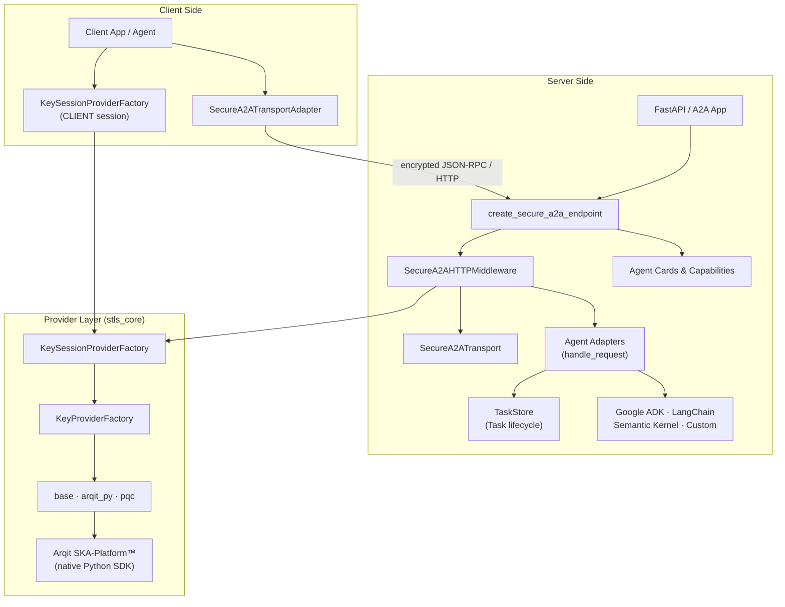

# STLS A2A Python SDK

STLS A2A Python SDK is the Python layer of the STLS-AI ecosystem for secure communication between agents, A2A services, and heterogeneous AI applications. Its role is to connect the STLS-AI secure transport model, key providers, and the most common agent frameworks through a uniform Python interface.

This README is intentionally architecture-oriented: it describes the system components, how they work together end to end, and where both the current elements and the components from earlier iterations of the project fit.

> **Note on `stls-core`.** As of `0.1.3`, the protocol-agnostic crypto, session
> management, handshake, key provider, and API key auth layers have been
> extracted into a sibling package, [`stls-core`](../stls-core), shared with
> `stls-mcp` (Model Context Protocol extension). `stls-a2a` depends on it and
> re-exports everything through its own public API, so existing import paths
> (`from stls_a2a import KeyProviderFactory, ApiKeyManager, ...`) keep working
> unchanged. Three key providers are available: `base` (dev/test, fixed key),
> `arqit_py` (Arqit SKA-Platform™, QKD-grade), and `pqc` (hybrid X25519 +
> ML-KEM-768, NIST FIPS 203, software-based, no external service required).
> This README documents the A2A-facing surface; see `stls-core`'s own README
> for the underlying crypto/session/provider/auth internals.

## Module Goals

The package addresses four main problems:

- protecting A2A and JSON-RPC messages with per-session symmetric encryption
- retrieving cryptographic key material through pluggable key providers
- adapting different AI frameworks behind a common secure A2A endpoint
- exposing discovery and standard metadata through agent cards and capability endpoints

Over time, the module evolved from a simple secure transport implementation into a small integration platform that now includes:

- secure transport for A2A messages
- client/server session providers obtained through factories
- integration with `base`, `arqit_py`, and `pqc` providers (key/session management lives in `stls-core`)
- support for Google ADK, LangChain, Semantic Kernel, and custom agents
- server-side authorization via `AuthConfig` and loader-based API key management (`StaticLoader`, `FileLoader`, `PostgresLoader`)
- grouped auth lifecycle with `ApiKeyManager.from_loader(...)`, `ApiKeyManagerGroup`, and `default_audit_hook()`
- Redis-backed key caching with namespace isolation and distributed refresh coordination
- optional PostgreSQL-backed `AgentRegistry` with heartbeat/liveness tracking for multi-agent deployments
- file passing support in the adapters
- generation and enrichment of agent cards
- built-in plain A2A client (`A2AClient`) for discovery, JSON-RPC calls, and SSE streaming
- A2A-standard task lifecycle (`messages/send`, `messages/sendStream`, `tasks/get`, `tasks/cancel`, `tasks/list`, `tasks/subscribe`)
- pluggable `TaskStore` backends (`memory` and `redis`) with typed message parts and artifacts
- single-agent, multi-agent, multi-card, and multi-backend auth scenarios

## Architecture

The system can be read as a layered pipeline: client application, session/key management, encrypted transport, server endpoint, framework adapters, task management, and the underlying key providers.



### End-to-End Logical Flow

1. The client obtains a session through `KeySessionProviderFactory`.
2. The provider resolves `session_key_identifier` and `session_key_data`.
3. `SecureA2ATransportAdapter` encrypts the JSON-RPC payload and sends it over HTTP.
4. The endpoint created with `create_secure_a2a_endpoint(...)` receives the encrypted request.
5. `SecureA2AHTTPMiddleware` retrieves or creates the transport for the session and decrypts the message.
6. `AgentAdapter.handle_request(...)` dispatches the method: standard A2A methods (`messages/send`, `tasks/get`, `tasks/cancel`, `tasks/list`) are handled directly; all other methods are forwarded to the framework adapter.
7. For `messages/send`, a `Task` is created in `TaskStore`, the user message is stored, the agent is invoked, and the completed task (with history and artifacts) is returned.
8. The response is encrypted and returned to the client.

## Component Map

### 1. Transport Layer

Components:

- `SecureA2ATransport`
- `A2AMessage`
- payload encryption/decryption utilities

Responsibilities:

- serializing the A2A message
- delegating encryption/decryption of the application payload to `stls_core.StlsTransport` (AES-256-GCM + HMAC-SHA256 + HKDF-Expand, shared with `stls-mcp`)
- binding a transport instance to a session identified by `session_id`

`SecureA2ATransport` is now a thin A2A-specific wrapper: it converts `A2AMessage` to/from JSON and calls into `stls_core.StlsTransport` for the actual cryptography. The wire format on the network is unchanged from earlier versions. This is the component closest to the STLS-AI wire protocol. For the broader protocol and framing context, see also [docs/STLS-AI-Wire-Protocol.md](../../docs/STLS-AI-Wire-Protocol.md).

### 2. HTTP/A2A Integration Layer

Components:

- `SecureA2ATransportAdapter`
- `SecureA2AHTTPMiddleware`
- `create_secure_a2a_endpoint(...)`
- `create_secure_agent_card(...)`
- `AuthConfig`

Responsibilities:

- adapting secure transport to FastAPI and Starlette
- exposing secure HTTP endpoints for A2A agents
- enforcing server-side authorization (bearer token and API key) via `AuthConfig`
- adding capability endpoints and security metadata
- bridging the A2A domain and the web runtime

This layer is the core of the Python-side application integration.

### 3. Agent Adapter Layer

Components:

- Google ADK adapter (`stls_a2a_google_adapter.py`)
- LangChain adapter (`stls_a2a_lc_adapter.py`)
- Semantic Kernel adapter (`stls_a2a_sk_adapter.py`)
- custom adapter (`stls_a2a_custom_adapter.py`)
- adapter factory `create_adapter(...)` and base types `AgentAdapter`, `AgentRequest`, `AgentResponse` (`stls_a2a_adapters.py`, `stls_a2a_adapters_model.py`)
- `AgentAdapter.handle_request(...)` dispatcher
- `a2a_to_agent_request(...)` and `agent_response_to_a2a(...)` conversions

Responsibilities:

- routing standard A2A methods (`messages/send`, `tasks/get`, `tasks/cancel`, `tasks/list`) before delegating to the adapter
- normalizing requests and responses across A2A and different frameworks
- mapping methods, prompts, structured input, and file attachments
- allowing callers to work with one interface regardless of the underlying agent framework

This is the component that enables the multi-framework scenario. The `handle_request` dispatcher was introduced to expose the standard A2A method surface alongside the existing proprietary interface.

### 4. Task and Message Layer

Components:

- `Task`, `TaskStoreBase`, `TaskStore`, `RedisTaskStore`
- `TaskState` (submitted, working, completed, failed, canceled, input-required)
- `Message`, `Artifact`
- `TextPart`, `FilePart` (`FileInline` / `FileReference`), `DataPart`
- `task_store` global singleton
- `start_task_store_cleanup(app)` lifecycle utility

Responsibilities:

- representing the full A2A task lifecycle with status tracking
- storing typed message history and artifacts per task
- providing a thread-safe in-memory store with TTL cleanup
- providing a Redis-backed store with shared state across multiple server instances
- decoupling the task model from the HTTP and cryptographic layers
- wiring automatic store cleanup to the FastAPI application lifecycle via `start_task_store_cleanup`

This layer was introduced to align the module with the core A2A protocol concept of a `Task` as the primary unit of work. Without it, the module relied entirely on proprietary methods; the `TaskStore` makes the server interoperable with standard A2A clients.

Task store backend selection is controlled with environment variables:

- `TASK_STORE_BACKEND`: `memory` (default) or `redis`
- `TASK_STORE_TTL_SECONDS`: task TTL in seconds (default `180`)
- `REDIS_URL`: Redis connection URL (default `redis://localhost:6379/0`)
- `REDIS_KEY_PREFIX`: key namespace prefix (default `stls`)

When `redis` is used, expiration is delegated to Redis TTL (`EXPIRE`) and cleanup scheduling becomes a no-op by design.

### 4b. Authorization, Cache, and Registry Layer

Components (re-exported from `stls_core.auth`, except `AgentRegistry` which remains A2A-specific):

- `AuthConfig`
- `ApiKeyManager`, `ApiKeyManagerGroup`, `default_audit_hook()`
- `StaticLoader`, `FileLoader`, `PostgresLoader`
- `RedisKeyCache`
- `AgentRegistry`

Responsibilities:

- validating API keys from in-memory, file-based, or PostgreSQL backends
- building managers with `ApiKeyManager.from_loader(...)` so Redis/cache behavior is derived from environment by default
- managing several auth backends under one FastAPI lifespan via `ApiKeyManagerGroup`
- isolating Redis namespaces per loader so different managers do not overwrite each other on the same Redis instance
- coordinating distributed refresh using per-namespace Redis locks
- auto-registering agents in PostgreSQL and maintaining heartbeat/liveness metadata for fleet-style deployments

Environment variables commonly used in this layer:

- `AUTH_KEYS_FILE`: YAML/JSON source for `FileLoader`
- `AUTH_PG_DSN`: PostgreSQL DSN for `PostgresLoader` and `AgentRegistry`
- `SF_API_KEYS_TABLE`: API key table name (default `sf_api_keys`)
- `AUTH_KM_USE_REDIS`: enables/disables Redis cache for key management
- `AUTH_REFRESH_INTERVAL`: refresh cadence in seconds
- `REDIS_URL`: Redis connection URL
- `BASE_URL`: preferred public base URL used for absolute agent URLs and registry entries

### 5. Provider and Session Management Layer

Components (re-exported from `stls_core.providers`):

- `KeyProvider`
- `KeyProviderClient`
- `KeyProviderServer`
- `KeySessionProvider`
- `KeyProviderFactory`
- `KeySessionProviderFactory`

Responsibilities:

- creating providers on the client and server side
- creating key sessions for each communication flow
- retrieving the session key identifier and key material

Providers currently available:

- `base`: minimal mock provider with a fixed key, useful for testing and debugging
- `arqit_py`: Arqit SKA-Platform™ provider using the native Python SDK (`uk.arqit.device.*`), quantum-safe key exchange via QKD, no JVM dependency
- `pqc`: hybrid X25519 + ML-KEM-768 (NIST FIPS 203) provider, quantum-safe software-based, no external service required. The key is derived via KEM exchange at handshake time through the dedicated `/stls/pqc/handshake` endpoint. Client-side: use `create_pqc_a2a_transport()` instead of the manual `provider → kid → key → adapter` sequence. Requires `liboqs-python` (`[pqc]` extra).

The JVM/JPype bridge (`simple` and `arqit` providers, Java STLS-AI SDK) has been removed as of `0.1.3`. Deployments previously using `KEY_PROVIDER_NAME=simple` or `arqit` must switch to `arqit_py`.

This layer now lives entirely in `stls-core`, making it directly shared with `stls-mcp`.

### 6. Discovery and Metadata

Components:

- `to_a2a(...)`
- `AgentCard`
- `AgentCapabilities`
- `SecurityScheme`
- `create_secure_agent_card(...)`

Responsibilities:

- describing agents in a standard form
- publishing technical and security capabilities
- supporting client discovery and bootstrap

This section covers a component that already existed in earlier project iterations and is now extended with secure transport metadata.

### 7. Application Components and Historical Demos

In addition to the package itself, the project includes example components that historically played an important role in validating the architecture:

- single-agent server
- single-agent client
- multi-agent server
- multi-agent client
- multi-card server
- multi-card client
- Arqit provider tests
- provider, transport, and card tests

These elements are not just operational examples. In practice, they are the module's reference scenarios and document components that were more explicit in earlier versions, such as the `Multi-Agent Server` and `Multi-Agent Client` concepts.

## Package Structure

Inside [src/stls_a2a](./src/stls_a2a) you will find:

- `stls_a2a_transport.py`: A2A message model (`A2AMessage`) and the thin `SecureA2ATransport` wrapper around `stls_core.StlsTransport`
- `stls_a2a_integration.py`: HTTP/A2A integration, middleware, and `AuthConfig`
- `stls_a2a_adapters.py`: adapter factory and `create_adapter(...)` dispatcher
- `stls_a2a_adapters_model.py`: base adapter types (`AgentAdapter`, `AgentRequest`, `AgentResponse`)
- `stls_a2a_google_adapter.py`: Google ADK adapter
- `stls_a2a_lc_adapter.py`: LangChain adapter
- `stls_a2a_sk_adapter.py`: Semantic Kernel adapter
- `stls_a2a_custom_adapter.py`: custom function adapter
- `stls_a2a_card_model.py`: `AgentCard` and capability data models
- `stls_a2a_task.py`: Task model, TaskStore, typed Part classes, and task lifecycle
- `stls_a2a_agent_registry.py`: PostgreSQL agent registry and heartbeat tracking
- `stls_a2a_utils.py`: A2A utilities, card builder, and client-side helpers
- `stls_a2a_client.py`: plain A2A utility client (card discovery, call, stream)
- `stls_a2a_remote.py`: `ContextualRemoteA2aAgent`, context propagation for `RemoteA2aAgent`

Crypto, session management, key providers (`base`, `arqit_py`, `pqc`), and the API key
auth system (`ApiKeyManager`, loaders, `RedisKeyCache`, ...) now live in the
sibling [`stls-core`](../stls-core) package and are re-exported transparently
through this package's public API. `create_pqc_a2a_transport()` (client-side
PQC session helper) is defined in `stls_a2a_integration.py` and exported from
the package root.

The public API exported by the package is defined in [src/stls_a2a/__init__.py](./src/stls_a2a/__init__.py).

## Requirements

- Python 3.12+
- the sibling [`stls-core`](../stls-core) package (resolved automatically as a monorepo dependency via `uv`)
- the Arqit SKA-Platform™ Python wheels if you use the `arqit_py` provider (proprietary, not redistributable — see `stls-core`'s README)
- `liboqs-python` if you use the `pqc` provider (`uv pip install -e ".[pqc]"`) — requires the liboqs C library version-aligned with the Python wrapper; see `stls-core`'s README for the alignment procedure

Main dependencies declared in [pyproject.toml](./pyproject.toml):

- `stls_core` (local monorepo dependency)
- `fastapi`, `uvicorn`, `httpx`
- `google-adk[a2a]`, `google-genai`
- `langchain`, `langchain-community`, `langchain-openai`, `langgraph`
- `semantic-kernel`
- `python-dotenv`
- `yfinance` (optional, `[examples]` extra)

## Installation

### Local Environment

`stls-a2a` expects `stls-core` as a sibling directory in the monorepo
(`python/stls-a2a` and `python/stls-core` at the same level). `uv` resolves
it automatically via `[tool.uv.sources]` in `pyproject.toml`.

```bash
python -m venv .venv
source .venv/bin/activate
pip install -e .
```

If you are using `uv` instead (recommended for the monorepo layout):

```bash
uv pip install -e .
```

With the Redis-backed auth cache, the Arqit `arqit_py` provider, or the PQC provider:

```bash
uv pip install -e ".[redis]"
uv pip install -e ".[pqc]"   # X25519 + ML-KEM-768, requires liboqs-python
uv pip install -e ".[arqit_py]" \
  --find-links arqit_wheels/arqit-skaplatform-common/ \
  --find-links arqit_wheels/arqit-skaplatform-policy/ \
  --find-links arqit_wheels/arqit-skaplatform-registration/ \
  --find-links arqit_wheels/arqit-skaplatform-provisioning/ \
  --find-links arqit_wheels/arqit-skaplatform-mqtt-common/ \
  --find-links arqit_wheels/arqit-skaplatform-peering/ \
  --find-links arqit_wheels/arqit-skaplatform-monitoring/
```

### Package Build

The current operational notes in [notes.md](./notes.md) use:

```bash
uv tool install build
uv tool install twine
uv tool run --from build pyproject-build
```

## Provider Configuration

Provider selection happens through `KeyProviderFactory` or, more commonly, through `KeySessionProviderFactory` (both re-exported from `stls_core`).

Available providers:

- `base`: minimal local provider with a fixed key, for testing and development
- `arqit_py`: Arqit SKA-Platform™ provider using the native Python SDK, configured from JSON files
- `pqc`: hybrid X25519 + ML-KEM-768 (NIST FIPS 203), software-based quantum-safe provider, no external service

Environment variables used:

- `KEY_PROVIDER_NAME`: provider to use — `base`, `arqit_py`, or `pqc`
- `ARQIT_PY_CLIENT_CONFIG`: JSON configuration for the Arqit client (initiator)
- `ARQIT_PY_SERVER_CONFIG`: JSON configuration for the Arqit server (receiver)
- `ARQIT_PY_TRANSPORT`: `socket` (default) or `mqtt`

Minimal example:

```bash
export KEY_PROVIDER_NAME=base
```

For Arqit:

```bash
export KEY_PROVIDER_NAME=arqit_py
export ARQIT_PY_CLIENT_CONFIG=/abs/path/client-config.json
export ARQIT_PY_SERVER_CONFIG=/abs/path/server-config.json
export ARQIT_PY_TRANSPORT=socket
```

For PQC (X25519 + ML-KEM-768):

```bash
export KEY_PROVIDER_NAME=pqc
# Nessuna configurazione aggiuntiva: i keypair sono generati on-the-fly.
# Il server registra automaticamente /stls/pqc/handshake.
# Il client usa create_pqc_a2a_transport() — vedi sezione Session Key Management.
```

Example configuration files are available in this directory and in [test](./test).

## TaskStore Backend Configuration

By default the SDK uses an in-memory store. To switch to Redis:

```bash
export TASK_STORE_BACKEND=redis
export REDIS_URL=redis://localhost:6379/0
export REDIS_KEY_PREFIX=stls
export TASK_STORE_TTL_SECONDS=180
```

To keep the default in-memory mode explicitly:

```bash
export TASK_STORE_BACKEND=memory
export TASK_STORE_TTL_SECONDS=180
```

Optional cleanup scheduling (used by memory backend):

```bash
export TASK_STORE_CLEANUP_INTERVAL=120
```

## Authorization and Agent Registry Configuration

For simple bearer-token or fixed API-key checks, `AuthConfig` is still sufficient. For current multi-agent deployments, the recommended path is loader-based key management via `ApiKeyManager.from_loader(...)`.

```python
import os

from stls_a2a import ApiKeyManager, FileLoader, PostgresLoader
from stls_a2a.stls_a2a_auth_manager import ApiKeyManagerGroup, default_audit_hook

file_manager = ApiKeyManager.from_loader(
    FileLoader(path=os.getenv("AUTH_KEYS_FILE", "api_keys.yaml")),
    audit_hook=default_audit_hook(),
)

pg_manager = ApiKeyManager.from_loader(
    PostgresLoader(dsn=os.getenv("AUTH_PG_DSN")),
) if os.getenv("AUTH_PG_DSN") else None

managers = ApiKeyManagerGroup().add("file", file_manager).add("postgres", pg_manager)
```

Useful environment variables:

- `AUTH_KEYS_FILE`: path to the YAML/JSON file used by `FileLoader`
- `AUTH_PG_DSN`: PostgreSQL DSN for `PostgresLoader`
- `SF_API_KEYS_TABLE`: API key table name (default `sf_api_keys`)
- `AUTH_KM_USE_REDIS`: set to `false` to bypass Redis and query the loader directly
- `AUTH_REFRESH_INTERVAL`: refresh cadence for background reloads
- `REDIS_URL`: Redis cache URL when shared cache is enabled
- `BASE_URL`: preferred public URL used for absolute cards and registry metadata

Ready-to-copy examples are included in [`env_basic_sample`](./env_basic_sample) and [`env_reg_keys_sample`](./env_reg_keys_sample).

## Practical Quick Start

Today, the most useful entry points are not top-level package scripts but the examples in [test](./test) and the shell scripts included in the module root.

### 1. Single-Agent A2A Server

```bash
./start_server_test.sh
```

This starts [test/adk_agent_server.py](./test/adk_agent_server.py), which exposes:

- agent card: `http://localhost:8001/.well-known/agent-card.json`
- secure endpoint: `http://localhost:8001/secure-a2a`

### 2. Single-Agent A2A Client

In a second terminal:

```bash
./start_client_test.sh
```

This runs [test/adk_client.py](./test/adk_client.py) and shows an encrypted call to the ADK agent.

### 3. Multi-Agent Demo

Server:

```bash
./start_server_multi.sh
```

Client:

```bash
./start_client_multi.sh
```

The multi-agent demo uses [test/multi_agent_server.py](./test/multi_agent_server.py) and [test/multi_agent_client.py](./test/multi_agent_client.py).

Agents exposed in the demo:

- `calculator`
- `adk-agent`
- `lc-agent`
- `sk-agent`
- `invoices-classifier`

### 4. Simple Multi-Agent Demo

A lightweight variant that requires only standard dependencies (no LangChain/Semantic Kernel):

Server:

```bash
./start_server_multi_simple.sh
```

Client:

```bash
./start_client_multi_simple.sh
```

The simple demo uses [test/multi_agent_server_simple.py](./test/multi_agent_server_simple.py) and [test/multi_agent_client_simple.py](./test/multi_agent_client_simple.py).

Agents exposed:

- `calculator`
- `gemini`
- `gpt4`

### 5. Task-Based A2A Demo

Server (same multi-agent server):

```bash
./start_server_multi.sh
```

Client using standard A2A methods:

```bash
./start_task_test.sh
```

This runs [test/task_test.py](./test/task_test.py), which uses `messages/send` and retrieves the agent response via the task history. The client includes helper utilities (`extract_a2a_text`, `extract_a2a_artifacts`, `extract_a2a_result`) to navigate the `Task` response structure.

### 6. Multi-Backend Auth and Registry Demo

Server:

```bash
./start_server_km_multi.sh
```

Client:

```bash
./start_km_test.sh
```

This demo starts [test/multi_agent_km_server.py](./test/multi_agent_km_server.py) and showcases:

- `StaticLoader` for `calculator`
- `FileLoader` for `adk-agent`
- `PostgresLoader` for `lc-agent` when `AUTH_PG_DSN` is set
- aggregated `/auth/health` and `/auth/refresh` endpoints via `ApiKeyManagerGroup`
- automatic PostgreSQL registry/heartbeat updates when `BASE_URL` and registry settings are configured

## Endpoint Structure

In the multi-agent case, the typical layout is:

```text
http://localhost:8001/
|
+-- /.well-known/agent-card.json
+-- /health
+-- /auth/health
+-- /auth/refresh
+-- /agents/calculator/.well-known/agent-card.json
+-- /agents/calculator/a2a                 (if plain endpoint is enabled)
+-- /agents/calculator/secure-a2a
+-- /agents/calculator/secure-a2a/stream
+-- /agents/adk-agent/.well-known/agent-card.json
+-- /agents/adk-agent/a2a                  (if plain endpoint is enabled)
+-- /agents/adk-agent/secure-a2a
+-- /agents/adk-agent/secure-a2a/stream
+-- /agents/lc-agent/.well-known/agent-card.json
+-- /agents/lc-agent/secure-a2a
+-- /agents/lc-agent/secure-a2a/stream
+-- /agents/sk-agent/.well-known/agent-card.json
+-- /agents/sk-agent/secure-a2a
+-- /agents/sk-agent/secure-a2a/stream
+-- /agents/invoices-classifier/.well-known/agent-card.json
+-- /agents/invoices-classifier/secure-a2a
+-- /agents/invoices-classifier/secure-a2a/stream
+```

Each secure endpoint also exposes `GET /secure-a2a/capabilities`. When `enable_plain_endpoint=True`, the corresponding plain `POST /a2a` endpoint is exposed as well.

## Using the Package as a Library

### Creating a Secure Endpoint for an Agent

```python
from fastapi import FastAPI
from stls_a2a import ApiKeyManager, FileLoader, create_secure_a2a_endpoint, start_task_store_cleanup
from stls_a2a import KeySessionProvider, KeySessionProviderFactory

app = FastAPI()

key_session_provider = KeySessionProviderFactory().get_session_provider(
    session_type=KeySessionProvider.KeySessionProviderType.SERVER,
    port=8081,
)

api_key_manager = ApiKeyManager.from_loader(
    FileLoader(path="api_keys.yaml")
)

start_task_store_cleanup(app=app)  # wires store cleanup to app lifecycle

create_secure_a2a_endpoint(
    app=app,
    agent=my_agent,
    key_session_provider=key_session_provider,
    base_url="http://localhost:8081",  # optional but recommended for absolute card URLs
    path="/secure-a2a",
    framework="auto",
    api_key_manager=api_key_manager,    # optional: loader-based authorization
)
```

`AuthConfig(...)` remains available when you only need simple bearer-token or fixed API-key checks.

Frameworks supported by the adapters:

- `auto`
- `google-adk`
- `langchain`
- `semantic-kernel`
- `custom`

For custom agents, the handler must return an `AgentResponse`:

```python
from stls_a2a import AgentResponse

async def my_handler(request):
    result = await my_logic(request.method, request.params)
    return AgentResponse(result=result, id=request.id)
```

### Creating a Secure Card

Agent cards are generated automatically by `create_secure_a2a_endpoint` using `to_a2a(...)`. You can also build a card explicitly:

```python
from stls_a2a import to_a2a, AgentCard

card: AgentCard = to_a2a(
    agent=my_agent,
    url="http://localhost:8001/agents/my-agent/a2a",              # plain endpoint
    secure_url="http://localhost:8001/agents/my-agent/secure-a2a", # encrypted endpoint
    description="My secure agent",
)
```

### Creating a Secure Client

```python
from stls_a2a import SecureA2ATransportAdapter

adapter = SecureA2ATransportAdapter(
    session_key=session_key_data,
    session_id=session_key_identifier,
    base_url="http://localhost:8001",
)

response = await adapter.send_secure_message({
    "jsonrpc": "2.0",
    "method": "generate",
    "params": {"prompt": "What is 2+2?"},
    "id": 1,
})

await adapter.close()
```

### Using the Built-In Plain A2A Client

`A2AClient` is useful when you want to call agents with standard JSON-RPC and SSE endpoints without handling transport details manually.

```python
from stls_a2a import A2AClient, extract_a2a_text

client = A2AClient("http://localhost:8001")

# discovery
agents = client.get_agents_list()

# sync JSON-RPC call
resp = await client.call(
    "financial_agent",
    "messages/send",
    {
        "message": {
            "role": "user",
            "parts": [{"type": "text", "text": "What is AAPL stock price?"}],
        }
    },
)

text = extract_a2a_text(resp)

# SSE stream
async for event in client.stream(
    "financial_agent",
    "messages/sendStream",
    {
        "message": {
            "role": "user",
            "parts": [{"type": "text", "text": "Stream TSLA quote"}],
        }
    },
):
    print(event)
```

### Using Standard A2A Methods

The adapters now route the standard A2A method set before delegating to the framework-specific implementation. Supported methods:

| Method | Description |
|---|---|
| `messages/send` (alias `message/send`) | creates a Task, invokes the agent, returns the completed Task |
| `messages/sendStream` (aliases `message/sendStream`, `message/stream`) | streams task updates via SSE |
| `tasks/subscribe` (alias `task/subscribe`) | subscribes to an existing task and streams status/artifact updates |
| `tasks/get` (alias `task/get`) | retrieves a task by `taskId` |
| `tasks/cancel` (alias `task/cancel`) | cancels a task |
| `tasks/list` (alias `task/list`) | lists tasks with optional `limit` and `cursor` |

Calling `messages/send` with the standard message structure:

```python
response = await adapter.send_secure_message({
    "jsonrpc": "2.0",
    "method": "messages/send",
    "params": {
        "message": {
            "role": "user",
            "parts": [{"type": "text", "text": "What are AAPL's latest prices?"}]
        }
    },
    "id": 1,
})
```

The response `result` is a `Task` object with `id` (alias `taskId`), `contextId`, `status` (object with `state`), `history`, and `artifacts`. Client-side helpers exported from the package:

```python
from stls_a2a import extract_a2a_text, extract_a2a_artifacts, extract_a2a_result

text = extract_a2a_text(response)               # last agent message as plain text
result, error = extract_a2a_result(response)    # (result dict, error dict) tuple
artifacts = extract_a2a_artifacts(response)     # list of Artifact dicts
```

For SSE/event-style flows, some integrations may wrap event payloads in a JSON-RPC envelope (`{"result": ...}`). Clients should read the inner `result` object when present.

Message parts follow a discriminated union: `TextPart`, `FilePart` (inline base64 or URI reference), or `DataPart` (arbitrary JSON structure).

## Session Key Management

The package uses `KeySessionProviderFactory` to obtain providers on the client or server side.

### Standard providers (base / arqit_py)

Client example:

```python
from stls_a2a import KeySessionProvider, KeySessionProviderFactory

provider = KeySessionProviderFactory().get_session_provider(
    session_type=KeySessionProvider.KeySessionProviderType.CLIENT,
    host="localhost",
    port=8081,
)

session_key_identifier = str(
    KeySessionProviderFactory().resolve_if_awaitable(
        provider.getSessionKeyIdentifier()
    )
)

session_key_data = bytes(
    KeySessionProviderFactory().resolve_if_awaitable(
        provider.getSessionKeyData(session_key_identifier)
    )
)
```

Important note: `resolve_if_awaitable()` (re-exported from `stls_core.KeySessionProviderFactory`) normalizes results that may be a Python coroutine, a Java-future-like object, or a direct value.

### PQC provider (X25519 + ML-KEM-768)

With `KEY_PROVIDER_NAME=pqc`, the key is derived via KEM exchange — no pre-shared key exists. Use `create_pqc_a2a_transport()` instead of the manual provider sequence:

```python
from stls_a2a import create_pqc_a2a_transport, SecureA2ATransportAdapter

# Un'unica chiamata: genera keypair, esegue handshake KEM, verifica proof
adapter = await create_pqc_a2a_transport(
    "http://localhost:8001",
    client_id="my-agent",
)

# adapter è già un SecureA2ATransportAdapter pronto all'uso
response = await adapter.send_secure_message({...})
```

`create_pqc_a2a_transport()` richiede che il server abbia registrato l'endpoint
`/stls/pqc/handshake` — questo avviene automaticamente in `create_secure_a2a_endpoint()`
quando `KEY_PROVIDER_NAME=pqc`. Richiede `liboqs-python` (`[pqc]` extra).

## File Support in Agent Adapters

The adapters support payloads with attached files via the `FilePart` type. The file can be sent inline as base64 (`FileInline`) or referenced by URI (`FileReference`). The standard `messages/send` part structure:

```python
params = {
    "message": {
        "role": "user",
        "parts": [
            {"type": "text", "text": "Does the file contain an invoice?"},
            {
                "type": "file",
                "file": {
                    "mimeType": mime_type,
                    "data": data_base64,   # FileInline
                }
            }
        ]
    }
}
```

A real example is available in [test/task_test.py](./test/task_test.py) and [test/multi_agent_client.py](./test/multi_agent_client.py), where the client sends a PDF to the `invoices-classifier` agent.

## Agent Cards and Discovery

For card generation you can use:

- `to_a2a(...)` to produce a standard A2A card (auto-detects framework from agent type)
- `create_secure_a2a_endpoint(...)` generates and exposes the card automatically

**Security scheme naming.** The `securityScheme` field on a generated card
uses the discriminator `"stls_key_exchange"` (class `StlsKeyExchangeSecurityScheme`
in `stls_a2a_card_model.py`) — a vendor-neutral name covering all three key
providers (`base`, `arqit_py`, `pqc`). Earlier versions used `"sparkle_ska"`,
tied to the Arqit Sparkle SKA product name even for the `pqc` provider,
which has no relation to Arqit at all. The active provider is still shown
in the card (`keyProvider` in both `securityScheme` and the STLS extension
params, e.g. `"keyProvider": "arqit_py"`) — that part is unchanged and
legitimate for interoperability; only the Arqit product branding
("Sparkle SKA") was removed from descriptions and from the scheme name
itself.

**Tool names for raw-function ADK tools.** `to_a2a(...)` on a Google ADK
agent whose `tools=[...]` list contains a raw Python function (not yet
wrapped by ADK into a `FunctionTool`, which depends on the ADK version)
now resolves the skill's `name`/`description` via `.name`/`.description`
first, then `.__name__`/first docstring line as a fallback for plain
callables. Previously this fell through to `str(tool)`, producing entries
like `<function send_report at 0x7f...>` in the public card — not a
stable identifier (the memory address changes every process) and useless
to any client reading the card.

Practical examples:

- [test/cards_test.py](./test/cards_test.py)
- [test/multi_agent_server.py](./test/multi_agent_server.py)

## Logging and Troubleshooting

Logging has been strengthened in the transport, provider, and integration layers. In particular:

- session resolution is traced
- the type of the value returned by the provider is traced
- the session key should not be logged in cleartext in production
- transport keys are now derived with HKDF-Expand using domain-separated labels for AES and HMAC material

Operational suggestions:

- use `KEY_PROVIDER_NAME=base` to isolate routing or adapter issues
- switch to `arqit_py` only after validating the application flow with `base`
- switch to `pqc` when you need software-based quantum safety without an external key service
- if you use Arqit, verify the JSON files passed through `ARQIT_PY_CLIENT_CONFIG` and `ARQIT_PY_SERVER_CONFIG`
- if you use `TASK_STORE_BACKEND=redis`, verify Redis reachability and `REDIS_URL` before running server demos
- if you use loader-based auth, check `/auth/health` and `/auth/refresh` before debugging the agent layer
- when exposing agents behind a proxy or Cloud Run, set `BASE_URL` so registry entries and absolute card URLs are populated correctly
- when multiple auth managers share one Redis instance, keep the default namespace separation unless you explicitly want them to share cache state

## Current Limitations and Notes

- the script documentation is centered on the examples in [test](./test), which currently also act as the best demo/manual validation suite
- stopping flows with `Ctrl+C` when using Arqit is still listed as an open point in the working notes
- session establishment for `base` and `arqit_py` is currently lazy (`session_id` embedded in the client's first encrypted request, resolved against the provider on cache miss); for `pqc`, the explicit HMAC challenge/response handshake from `stls-core` is wired via `/stls/pqc/handshake` — session_id is server-generated and the key never transits on the wire. Extending the explicit handshake to `base` and `arqit_py` is tracked as follow-up work
- multi-agent PQC with `SESSION_CACHE_BACKEND=memory`: the `/stls/pqc/handshake` endpoint is tied to the first agent's `SessionCache`; clients calling other agents with the same session need `SESSION_CACHE_BACKEND=redis` (standard requirement for any multi-replica deployment)
- `ContextualSecureRemoteA2aAgent`/`SecureSessionManager` (`stls_a2a_secure_remote.py`) — the drop-in encrypted replacement for ADK's `RemoteA2aAgent` — now supports all three key providers via an opt-in `provider_name=` argument (`SecureSessionManager(provider_name="base" | "arqit_py" | "pqc")`, or `ContextualSecureRemoteA2aAgent(..., provider_name=...)` when not sharing a manager). The default stays `pqc`, exactly as before adding this — no behavior change for existing callers that don't pass it.
  - `pqc`: unchanged — lazy KEM handshake against `/stls/pqc/handshake` on first call.
  - `base`: resolves instantly through `KeySessionProviderFactory().get_session_provider(...)` (fixed pre-shared key, no handshake round-trip) — no server-side change needed, `create_secure_a2a_endpoint()` already serves `/secure-a2a` regardless of provider.
  - `arqit_py`: same generic `KeySessionProviderFactory` path. By default `create_provider_client()` still reads `ARQIT_PY_CLIENT_CONFIG` straight from the process environment (`host`/`port` are accepted but ignored — see `stls_core_providers_arqit_py.py`), one config for the whole process when no override is given.
    - Implemented: `KeyProviderArqitPy.create_provider_client()`/`create_provider_server()` read `config_path` from the existing `options: dict` parameter first, falling back to `ARQIT_PY_CLIENT_CONFIG`/`ARQIT_PY_SERVER_CONFIG` when absent — no change to the shared `KeyProvider` ABC signature. `KeySessionProviderFactory.get_session_provider()` has an optional `options` passthrough (previously hardcoded to `{}`). `SecureSessionManager` has an optional static `arqit_client_configs={base_url: config_path}` mapping on its constructor, consulted by `_resolve_via_key_session_provider(base_url)`; when no mapping is given, or no entry matches a given `base_url`, behavior is unchanged — it falls back to `ARQIT_PY_CLIENT_CONFIG` exactly as before this option existed.
    - This mapping is resolved entirely client-side and is never derived from the remote agent's card. An earlier draft of this note floated extending the agent card instead (an extension carrying "device identity / config reference") — that direction doesn't fit the client's own config: `ARQIT_PY_CLIENT_CONFIG` holds the client's own device credentials (realm username/password, Q-key, local file paths) decided and owned solely by the client; a remote server has no business dictating, or even seeing, which config the client uses for it. The only thing a card could ever legitimately carry is the *server's own* device identity (public information about itself), letting a client auto-match it against its own already-provisioned local configs instead of hardcoding the static map above — a discovery convenience, never a channel for the server to choose the client's config. No such card extension exists or is currently planned; the static map covers the actual need.
    - 1 client → N servers: share one `SecureSessionManager` across all `ContextualSecureRemoteA2aAgent` instances (as already recommended for PQC/base) and pass `arqit_client_configs` on that shared manager — one process can then hold several `(base_url, config_path)` entries instead of the N-independent-processes workaround this used to require. **Validated against the real Arqit cloud for the sequential case** (`samples/client/10_client_ms/client.py` + `samples/server/10_server_ms/server_ms_{1,2}`, 2026-10-23): one client process, two distinct device identities via `arqit_client_configs`, each fully authenticated/peered/used end-to-end (real bilocation+P2P key agreement, real encrypted A2A round trip) before moving to the next — both servers answered correctly.
    - **`DeviceMetadata` singleton race — confirmed real, now mitigated by a process-wide lock (2026-10-23).** `uk.arqit.device.common.device_metadata.DeviceMetadata.get_instance(cfg)` is a true process-wide singleton (`.config` unconditionally overwritten on every call, regardless of which device's `cfg` is passed), and `AuthenticationClient.__mutex` (the Arqit SDK's own internal lock around `DeviceMetadata.load()`) is a *class*-level lock shared by every `AuthenticationClient` instance in the process, with no `try`/`finally` around the critical section it guards. Confirmed by direct reproduction against the real cloud (dedicated throwaway devices, `python/stls-core/tests/test_arqit_py_same_device_concurrent_real.py`, `py-spy` thread dumps): with no protection, concurrent `start()` calls for the same device deadlocked forever inside the SDK's own `authenticate_device()` — an unrelated exception during one call's critical section leaked that class-level mutex permanently, wedging every later call in the process. **Fix**: `stls_core_providers_arqit_py.py` now has a module-level `_ARQIT_PY_START_LOCK` (`threading.Lock`) that fully serializes `KeyProviderClientArqitPy.start()`/`KeyProviderServerArqitPy.start()` process-wide — across *all* devices, not just the same one, since `DeviceMetadata` is one global singleton regardless of which config is passed. Serializing authentication alone wasn't enough: letting a second session authenticate while a first session's negotiation was still connecting made the SDK's socket bilocation handshake fail outright (`ConnectionRefusedError`/`PeerUnableToConnectException`) for every session involved — so the client-side lock is held through the *full* negotiation (joins the negotiation thread, up to a 30s cap matching this provider's own key-delivery timeout, before releasing), not just through authentication. **Confirmed fixed**: the same 3-concurrent-sessions-same-device reproduction that previously deadlocked forever now completes in ~5s with 3/3 distinct keys and no errors, against the real cloud. **Residual limitation, by design, until Arqit fixes their SDK**: this makes `arqit_py` session establishment (`start()`) fully serial process-wide — no two `arqit_py` sessions, same device or not, same role or not, can ever be mid-authentication/negotiation concurrently in one process. This is a throughput cost, not a correctness one: multi-config/multi-session `arqit_py` usage (both the N-servers and the N-concurrent-sessions-to-one-server shapes) is safe to call concurrently (e.g. via `asyncio.gather()`/`asyncio.to_thread()`) now — the lock reduces it to the same sequential behavior `SecureSessionManager`'s own `for` loop already used, just enforced at the lowest level instead of relying on callers to avoid parallelizing it themselves. One clean full-pass run is the standard of evidence here, not two back-to-back ones: an immediate retry against the same throwaway devices right after the clean pass hit `ConnectionRefusedError` again, consistent with this project's own already-documented real-cloud rate-limiting/flakiness on back-to-back retries (see `sidecar/ARQIT_PEERING_NOTES.md`) — space retries out, don't chase a second green run as proof. On the server side a single `ARQIT_PY_SERVER_CONFIG` is enough regardless of how many clients peer with it — the server is one device identity accepting connections, it isn't per-client.
    - **Regression found and fixed while re-verifying the fix above against the Redis-backed key store (2026-10-23, same day).** `KeySessionProviderArqitPy.__init__()` snapshots `key_store.startup_seen_keys()` to pre-seed `_delivered_key_ids` with whatever is already sitting in the store, so a restarted process doesn't mistake old leftover keys for a fresh negotiation's result. The first version of the `start()` fix above built this session object *after* joining the negotiation thread — so by the time the snapshot ran, the negotiation it had just waited for had already pushed all its own keys into the store, and every one of them got wrongly absorbed into "already seen." Every subsequent `getSessionKeyIdentifier()` call then waited forever for a "new" key that would never come, since the negotiation was already finished. Caught by re-running `samples/client/10_client_ms/client_multi_server.py` (the Redis-backed path — the throwaway-device diagnostic above uses an in-memory store, which has no persistence to snapshot anything stale from, so it never exercised this). **Fixed** by building `self._session` (and thus taking that snapshot) *before* starting the negotiation thread, not after joining it — restores the original ordering while keeping the full-negotiation lock scope. Confirmed fixed: `client_multi_server.py` now reaches a real `200 OK` from both secure endpoints (only the downstream Gemini call fails, with the already-known, unrelated `402 RESOURCE_EXHAUSTED` quota error); the throwaway same-device concurrency reproduction was re-run afterward too and still passes (3/3 distinct kids, no errors) — the reordering didn't reopen the concurrency fix.
    - `KEY_SESSION_HOST`/`KEY_SESSION_PORT` have **no effect at all** on `arqit_py`, on either side: `KeyProviderArqitPy.create_provider_client(host, port, options)` and `create_provider_server(port, options)` never read their `host`/`port` arguments (`stls_core_providers_arqit_py.py:481-509`). The real peer address/port always comes from the JSON config (`SOCKET_RECEIVER_IP_ADDRESS`/`PORT` on the client side, `SOCKET_LISTENING_PORT` on the server side) — a comment in `stls-mcp/tests/vault_server.py` used to claim `KEY_SESSION_PORT` drives the server's listening port, which is stale/inaccurate for `arqit_py` and has been corrected.
    - `ARQIT_PY_TRANSPORT` (`"socket"` default | `"mqtt"`) is read identically by both sides via `KeyProviderArqitPy._get_transport()` and must be set consistently on client and server (and match the corresponding `SOCKET_*`/`MQTT_*` fields in their respective JSON configs) — it is a process-wide transport choice, not something that varies per counterpart.

## Useful Files in This Folder

- [pyproject.toml](./pyproject.toml): package metadata and dependencies
- [notes.md](./notes.md): quick build/install notes
- [todo.md](./todo.md): feature progress notes
- [test](./test): runnable demos and examples

## Functional Summary

At the moment, the module covers:

- secure transport A2A (AES-256-GCM + HMAC-SHA256 with HKDF-separated key material, via `stls_core.StlsTransport`)
- multi-framework integration (Google ADK, LangChain, Semantic Kernel, custom)
- `base`, `arqit_py`, and `pqc` key providers (via `stls_core.providers`); PQC client helper `create_pqc_a2a_transport()`
- client/server session management via factories
- server-side authorization via `AuthConfig` or loader-based API key management (`StaticLoader`, `FileLoader`, `PostgresLoader`, via `stls_core.auth`)
- `ApiKeyManager.from_loader(...)`, `ApiKeyManagerGroup`, default audit hooks, and Redis-backed key caching with namespace isolation
- optional PostgreSQL `AgentRegistry` with heartbeat/liveness tracking for agent fleets
- A2A-standard task lifecycle: `messages/send`, `messages/sendStream`, `tasks/get`, `tasks/cancel`, `tasks/list`, `tasks/subscribe`
- pluggable `TaskStore` backend (`memory` / `redis`) with typed parts (`TextPart`, `FilePart`, `DataPart`) and `Artifact` tracking
- automatic `TaskStore` cleanup via `start_task_store_cleanup` (memory backend) and native Redis TTL expiration (redis backend)
- `AgentResponse` as the standard return type for custom adapters
- file support for document-oriented use cases (inline base64 and URI reference)
- standard agent cards built automatically via `to_a2a(...)` with per-framework introspection; PQC reflected in `securityScheme` and extension params
- client-side helpers: `extract_a2a_text`, `extract_a2a_artifacts`, `extract_a2a_result`
- single-agent, multi-agent, simple multi-agent, and task-based demos
- adapter layer split into per-framework modules (`google`, `langchain`, `sk`, `custom`)
- crypto, session, provider, and auth internals shared with `stls-mcp` through the `stls-core` package
- crypto, session, provider, and auth internals shared with `stls-mcp` through the `stls-core` package

## License

Dual-licensed under the [GNU AGPLv3](LICENSE) and a
[commercial license](LICENSE-COMMERCIAL.md), consistent with `stls-core`
and `stls-mcp`. The Arqit SKA-Platform™ wheels remain subject to the
proprietary Arqit license.