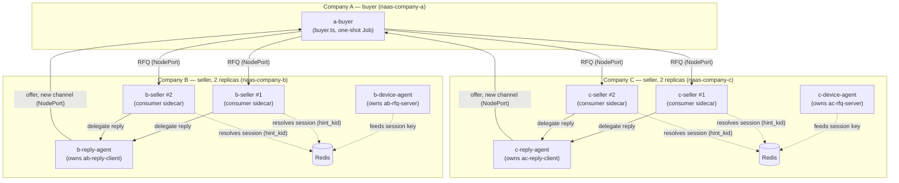

# 18_naas_federation — NaaS RFQ federation (issue #38)

A buyer company requests a network-as-a-service quote from two seller
companies at once, compares the two real offers, and picks the
cheaper one — while each seller's receiving side runs as **2
replicas** sharing one real Arqit device via the device-agent/consumer
split (issue #38). Built gradually and validated end to end on a real
minikube cluster, with both the `pqc` provider (fast, no cloud
dependency, used to validate the K8s mechanics) and the real
`arqit_py` provider (slower, needs real registered devices, used to
validate the actual business scenario).

## Why this sample exists

Issue #38 is about one real Arqit device being shared safely across
N replicas of a service, instead of each replica independently
authenticating the device (which can brick it — see
`python/stls-core/sidecar/ARQIT_PEERING_NOTES.md`). The mechanism
(`arqit_device_agent.py` as the one owner, `ARQIT_PY_DEVICE_ROLE=consumer`
sidecars as read-only consumers, Redis as the hand-off) was built and
unit/integration-tested in `samples/server/16_server_device_agent` and
`samples/peer/17_peer_*_core`. This sample puts it in the shape the
mechanism actually motivated: a multi-party federation where a
**seller's receiving side is the thing under real concurrent load**
(two buyers, or — here — one buyer hitting both of its sellers at
once) and needs to scale horizontally without re-authenticating the
device on every replica.

## Architecture



Each arrow between companies is a **physically separate STLS channel**
(its own handshake, its own session, its own real Arqit device pair
for `arqit_py`) — same two-independent-channels shape as
`samples/peer/{14,17}_peer_*_core`. The RFQ (A → B/C) and the offer
reply (B/C → A) never share a session or a device.

Namespaces stand in for **geographically distributed clusters**: a
real deployment would have each company's infrastructure on entirely
separate clusters, possibly different clouds. Cross-company traffic
therefore only ever uses NodePort-exposed Services, never in-cluster
Service DNS, even though this sample happens to run everything in one
minikube cluster for convenience. Intra-company traffic (a seller's
replicas calling its own reply-agent) does use plain ClusterIP Service
DNS — that's genuinely the same company's own infrastructure.

### The device-agent/consumer split (issue #38's actual subject)

Each seller's **receiving** side (the thing a buyer's RFQ hits) is
replicated: 2 identical seller pods, neither of which ever
authenticates the real device itself. A separate, singleton
`arqit_device_agent.py` process authenticates the device once and
feeds the negotiated session key into Redis; each seller replica
resolves that same session via `ARQIT_PY_DEVICE_ROLE=consumer` +
`hint_kid`, with zero device authentication of its own. Either
replica can serve either buyer's request — which one actually does is
irrelevant, by design.

### Why there's also a `reply_agent.ts` (and why it's sample-specific)

The seller's **reply** — going back out to the buyer on a brand-new
channel — is a CLIENT-role negotiation, and negotiating a session
inherently means authenticating the device. There is no
consumer-mode equivalent for the CLIENT role: nothing to "read" from
a shared store, because the reply's session doesn't exist until the
reply is actually sent. If both seller replicas tried to own that
reply device, they'd race for it — exactly the incident issue #38 was
about, just on the other role. `reply_agent.ts` is a tiny singleton
that owns the reply device(s) directly; the seller replicas delegate
to it over one internal HTTP call (`REPLY_MODE=delegate`) instead of
negotiating anything themselves.

This was deliberately **not** generalized into a `python/stls-core/sidecar/`
component (unlike the device-agent, which is a real library-adjacent
artifact reusable by any sample). The asymmetry between the two roles
— "authenticate once, serve forever" vs. "every use is a fresh
negotiation" — means a generic CLIENT-role equivalent would be a
request/response worker, not a passive feeder: a different shape of
component, not a drop-in reuse of the device-agent pattern. Worth
building if a second sample needs it; not worth generalizing from one
data point.

## Running with `pqc` (fast, no real devices needed)

Validates the K8s wiring itself — namespaces, Services, NodePort
cross-company routing, Redis-backed session sharing across replicas —
without touching the real Arqit cloud. Covers the 2-company shape
(company-a buying from company-b only); the third company was added
specifically to exercise the real `arqit_py` business scenario (two
real offers to compare) and was validated with `pqc` mechanics already
proven at that point.

### 1. Build and load the app image

```bash
cd /path/to/stls-ai
docker build -f samples/peer/18_naas_federation/app/Dockerfile -t naas18-app:dev .
minikube image load naas18-app:dev
```

### 2. Apply the namespaces, Redis, and company-b

```bash
cd samples/peer/18_naas_federation/k8s
kubectl apply -f 00-namespaces.yaml
kubectl apply -f pqc/05-redis.yaml
kubectl apply -f pqc/20-company-b.yaml
```

Wait for `b-seller` (2/2 replicas) and `b-reply-agent` to be `Running`:

```bash
kubectl get pods -n naas-company-b
```

### 3. Run the buyer

```bash
kubectl apply -f pqc/10-company-a.yaml
kubectl logs -n naas-company-a -l app=a-buyer -c a-buyer -f
```

Expect `RESULT: PASS` once the quote comes back. Re-run as many times
as you like:

```bash
kubectl delete job -n naas-company-a a-buyer
kubectl apply -f pqc/10-company-a.yaml
```

## Running with `arqit_py` (real devices, the actual scenario)

This needs 8 real, dedicated Arqit devices (4 per buyer↔seller
relationship: a CLIENT+SERVER pair for the RFQ, a CLIENT+SERVER pair
for the reply — see `python/stls-core/sidecar/ARQIT_PEERING_NOTES.md`'s
port registry) and the Python sidecar image.

### 1. Build and load the Python sidecar image

```bash
cd /path/to/stls-ai
docker build -f python/stls-core/sidecar/Dockerfile -t naas18-sidecar:dev .
minikube image load naas18-sidecar:dev
```

### 2. Create the namespaces (secrets in step 4 need them to exist)

```bash
cd samples/peer/18_naas_federation/k8s
kubectl apply -f 00-namespaces.yaml
cd ../..
```

### 3. Register and provision the 8 devices

One relationship = 4 devices, and **each device PAIR (the CLIENT and
SERVER that negotiate together) must share the same
`SOCKET_LISTENING_PORT`/`SOCKET_RECEIVER_PORT`** in their own config —
this is Arqit's own bilocation/peering socket addressing, a different
and lower-level thing than this sample's STLS/HTTP traffic. Getting
this wrong produces `PeerUnableToConnectException` with a
`ConnectionRefusedError` underneath, not an auth error.

| Device | Role | Owned by | Shared port with |
|---|---|---|---|
| `sf-p18-ab-rfq-client` | CLIENT | company-a | `sf-p18-ab-rfq-server` |
| `sf-p18-ab-rfq-server` | SERVER | company-b device-agent | `sf-p18-ab-rfq-client` |
| `sf-p18-ab-reply-client` | CLIENT | company-b reply-agent | `sf-p18-ab-reply-server` |
| `sf-p18-ab-reply-server` | SERVER | company-a | `sf-p18-ab-reply-client` |
| `sf-p18-ac-rfq-client` | CLIENT | company-a | `sf-p18-ac-rfq-server` |
| `sf-p18-ac-rfq-server` | SERVER | company-c device-agent | `sf-p18-ac-rfq-client` |
| `sf-p18-ac-reply-client` | CLIENT | company-c reply-agent | `sf-p18-ac-reply-server` |
| `sf-p18-ac-reply-server` | SERVER | company-a | `sf-p18-ac-reply-client` |

Register each device with `register_device.py` (needs the root venv
with `stls-core[arqit_py]` installed — see `python/stls-core/README.md`
— and a real, already-registered device config somewhere in the repo
to use as the account-credentials template; override with
`ARQIT_TEMPLATE_CONFIG` if the default doesn't apply to your account):

```bash
cd samples/peer/18_naas_federation
python register_device.py sf-p18-ab-rfq-client   9101
python register_device.py sf-p18-ab-rfq-server   9101
python register_device.py sf-p18-ab-reply-client 9103
python register_device.py sf-p18-ab-reply-server 9103
python register_device.py sf-p18-ac-rfq-client   9105
python register_device.py sf-p18-ac-rfq-server   9105
python register_device.py sf-p18-ac-reply-client 9107
python register_device.py sf-p18-ac-reply-server 9107
```

This writes each device's config+metadata under `devices/` (gitignored
— `aq-*.json`, contains real credentials). Then fix up the 4 CLIENT
devices' own peering-socket receiver address so it's reachable
**across pods** (not `localhost` — the two devices of a pair run in
different pods, sometimes different namespaces/companies). This only
needs `minikube` running (for `minikube ip`) — the 4 NodePort numbers
below are fixed in advance, by `k8s/arqit_py/01-peering-sockets.yaml`
(applied in step 5), not something you look up afterward:

```bash
MINIKUBE_IP=$(minikube ip)
python fix_client_receiver.py sf-p18-ab-rfq-client   "$MINIKUBE_IP" 30910
python fix_client_receiver.py sf-p18-ab-reply-client "$MINIKUBE_IP" 30911
python fix_client_receiver.py sf-p18-ac-rfq-client   "$MINIKUBE_IP" 30912
python fix_client_receiver.py sf-p18-ac-reply-client "$MINIKUBE_IP" 30913
```

(The 4 NodePort numbers above are `k8s/arqit_py/01-peering-sockets.yaml`'s
own choice, not anything Arqit-specific — change both together if you
edit that file.)

### 4. Create the per-company Secrets from the registered device files

```bash
D=samples/peer/18_naas_federation/devices
kubectl create secret generic p18-devices-a -n naas-company-a \
  --from-file="$D/aq-sf-p18-ab-rfq-client.json" --from-file="$D/aq-sf-p18-ab-rfq-client_metadata.json" \
  --from-file="$D/aq-sf-p18-ab-reply-server.json" --from-file="$D/aq-sf-p18-ab-reply-server_metadata.json" \
  --from-file="$D/aq-sf-p18-ac-rfq-client.json" --from-file="$D/aq-sf-p18-ac-rfq-client_metadata.json" \
  --from-file="$D/aq-sf-p18-ac-reply-server.json" --from-file="$D/aq-sf-p18-ac-reply-server_metadata.json"

kubectl create secret generic p18-devices-b -n naas-company-b \
  --from-file="$D/aq-sf-p18-ab-rfq-server.json" --from-file="$D/aq-sf-p18-ab-rfq-server_metadata.json" \
  --from-file="$D/aq-sf-p18-ab-reply-client.json" --from-file="$D/aq-sf-p18-ab-reply-client_metadata.json"

kubectl create secret generic p18-devices-c -n naas-company-c \
  --from-file="$D/aq-sf-p18-ac-rfq-server.json" --from-file="$D/aq-sf-p18-ac-rfq-server_metadata.json" \
  --from-file="$D/aq-sf-p18-ac-reply-client.json" --from-file="$D/aq-sf-p18-ac-reply-client_metadata.json"
```

### 5. Apply everything else, in order

```bash
cd samples/peer/18_naas_federation/k8s
kubectl apply -f 02-device-storage.yaml          # PVCs -- see "Notes" below for why
kubectl apply -f pqc/05-redis.yaml                # company-b's Redis (shared with arqit_py)
kubectl apply -f pqc/05-redis-c.yaml              # company-c's Redis
kubectl apply -f arqit_py/01-peering-sockets.yaml # Arqit's own peering-socket NodePorts
kubectl apply -f 06-company-b-device-agent.yaml
kubectl apply -f 07-company-c-device-agent.yaml
# wait for both device-agents to be 1/1 Running before continuing
kubectl apply -f arqit_py/20-company-b.yaml
kubectl apply -f arqit_py/30-company-c.yaml
# wait for both companies' seller+reply-agent pods to be Running
kubectl apply -f arqit_py/10-company-a.yaml
kubectl logs -n naas-company-a -l app=a-buyer -c a-buyer -f
```

Expect two real quotes and `RESULT: PASS`:

```
company-a (buyer) listening on port 8601 -- targets: company-b, company-c
[company-a] sending RFQ to company-b on a new channel (session_id=...)
[company-a] quote from company-b (session=...): 103 EUR
[company-a] sending RFQ to company-c on a new channel (session_id=...)
[company-a] quote from company-c (session=...): 103 EUR
[company-a] all 2 quotes received: {"company-b":103,"company-c":103}
[company-a] most advantageous offer: company-b at 103 EUR
RESULT: PASS
```

Re-run with:

```bash
kubectl delete job -n naas-company-a a-buyer
kubectl apply -f arqit_py/10-company-a.yaml
```

## Inspecting what's happening

**Redis** (one instance per company, holds the handshake session
cache AND, for `arqit_py`, the device-agent's negotiated session key
— two different things, two different key prefixes):

```bash
# All keys for a company
kubectl exec -n naas-company-b deployment/redis -- redis-cli KEYS '*'

# Just the device-agent's own key-store namespace
kubectl exec -n naas-company-b deployment/redis -- redis-cli KEYS 'stls:ks:p18-ab-rfq:*'

# Just the shared StlsTransport session cache
kubectl exec -n naas-company-b deployment/redis -- redis-cli KEYS 'stls:sc:*'

# Whether the device-agent's owner lock is currently held, and for how long
kubectl exec -n naas-company-b deployment/redis -- redis-cli GET "stls:ks:p18-ab-rfq:device-lock:owner-lock"
kubectl exec -n naas-company-b deployment/redis -- redis-cli TTL "stls:ks:p18-ab-rfq:device-lock:owner-lock"
```

**Which seller replica actually handled which request** (proves the
device-agent/consumer split is really load-balancing, not luck):

```bash
kubectl logs -n naas-company-b -l app=b-seller -c b-seller --prefix
```

**Real device authentication** (per sidecar container — each owns
exactly one device):

```bash
kubectl logs -n naas-company-b -l app=b-device-agent -c device-agent
kubectl logs -n naas-company-a <pod> -c sidecar-ab-rfq-client
```

**Pod/Deployment health across all three namespaces:**

```bash
for ns in naas-company-a naas-company-b naas-company-c; do
  echo "=== $ns ==="; kubectl get pods -n "$ns"
done
kubectl get pvc -A
```

## Notes on real-cloud device auth

A few things found the hard way while bringing up the `arqit_py` pass
on real K8s, independent of the device-agent/consumer mechanism
itself (which worked correctly throughout):

- **`SessionCache` defaults to in-memory, per-process**
  (`SESSION_CACHE_BACKEND=memory`, the `node/stls-core` default). With
  2 seller replicas behind one plain Service, a handshake and its
  follow-up `/notify` call can land on different pods — the second
  pod never saw that handshake. Fix: `SESSION_CACHE_BACKEND=redis` +
  `SESSION_CACHE_REDIS_URL` (`RedisSessionCache`, already built into
  `node/stls-core`, just needs wiring up). This sample's own
  `sessionSource`/`sessionTarget` maps (which named relationship a
  session belongs to) had the exact same gap one layer up — fixed the
  same way, same Redis instance, a different key prefix.
- **Kubernetes `Secret` volumes are always read-only**, regardless of
  the volumeMount's own `readOnly` field — but `authenticate_device()`
  rewrites the device's own metadata file on every call. A plain
  `emptyDir` seeded from the Secret is wrong here too, for a subtler
  reason: it gets re-seeded on every pod recreation, replaying
  already-superseded credential state. Fix: a PVC (survives pod
  recreation), seeded from the Secret only once, on true first use —
  and seeded **file by file**, each only if that specific file is
  still missing, never a blanket "copy everything if anything's
  missing" (which would silently overwrite an already-good, already-
  rotated file the moment one *other* file needs seeding — e.g. when
  a second relationship's devices are added to the same Secret).
- **A singleton process that holds an exclusive device-owner lock
  needs `strategy: { type: Recreate }`**, not the default
  `RollingUpdate` — the new pod can never pass its own owner-lock
  check while the old one is still up, and the old one then never
  becomes eligible for termination either. Deadlock, not a timeout.
- **`ARQIT_PY_DEVICE_AUTH_STAGGER_MS`** (`buyer.ts`, default 3000ms):
  when one process owns more than one real `arqit_py` device, their
  authentications are spaced out by this many milliseconds. If you
  see authentication failures when deploying this sample fresh
  against your own Arqit account, try increasing it; set it to `0` to
  disable.

## Known limitations

- The buyer side (company-a) is never replicated in this topology —
  only the seller side is, since that's issue #38's actual subject.
  Replicating a buyer would hit the same CLIENT-role limitation
  `reply_agent.ts` already works around on the seller side, just for
  outbound RFQs instead of replies.
- `pqc`'s own manifests only cover the 2-company shape (company-a ↔
  company-b) — extending them to 3 companies would be a trivial copy
  of `arqit_py`'s own company-c manifests with the provider swapped,
  not yet done since it wasn't needed to validate anything new.
