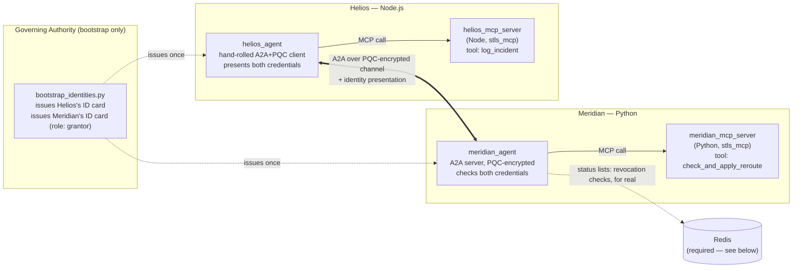

# 20_operator_identity_federation — Meridian ↔ Helios

A demo for anyone who needs to understand *what* `stls-identity`'s two
credential types are for and *why* cross-language interoperability
matters here — not just for developers. No crypto background assumed;
run it and read along.

## The story

**Meridian** and **Helios** are two network operators in a federation
agreement. Meridian is built in Python. Helios is built in Node.js —
two completely independent codebases, two different companies, no
shared database, no shared library beyond the open credential format
both sides speak.

During an incident, Helios needs Meridian to reroute traffic on a
network segment Helios doesn't own (`MER-SEG-7`). Meridian already
agreed to this, ahead of time: it handed Helios a digital **permission
slip** for exactly this situation. When the moment comes, Helios shows
up with two things:

1. **A permission slip** (an *Operational Credential*) — "Meridian
   authorized me, specifically, to call `reroute_traffic` on
   `MER-SEG-7`, until this time today."
2. **A copy of Meridian's own ID card** (a *Network Authority
   Credential*) — because a permission slip is only as trustworthy as
   whoever signed it. Meridian hands over a copy of its own ID
   alongside every slip it issues, precisely so this can be checked
   every time, not just once.

Meridian checks both, together, every time Helios calls: is the slip
genuine and still valid, *and* is Meridian's own standing (the thing
that makes the slip worth anything) still good right now? Being a
recognized partner and being authorized to do one specific thing are
two different guarantees — this demo makes that difference impossible
to miss.

## What you'll actually see run

Six real, independent processes, two languages, zero code shared
between the Python and Node halves beyond the wire format itself:



1. `bootstrap_identities.py` (Python) plays the Governing Authority for
   a moment: issues Helios's ID card, issues Meridian's ID card (with
   the `grantor` role, required before Meridian may delegate anything
   at all), then has Meridian issue Helios the permission slip. Two
   copies of the slip are actually issued — one valid for ~10 minutes,
   one already expired — for the "bad delegation" step below.
2. `meridian_agent` (Python) is the only thing Helios ever talks to
   directly: an A2A agent with exactly one real skill
   (`reroute_traffic`), behind a PQC-encrypted channel, gated by
   `stls_identity`'s `RequestPresentationVerifier`.
3. `meridian_mcp_server` (Python) is Meridian's own internal tool —
   Meridian calls it over MCP, *after* the identity check already
   passed, to actually (simulate) applying the reroute.
4. `helios_agent` (Node.js) is Helios's side of the call — see "Why
   there's no `node/stls-a2a`" below.
5. `helios_mcp_server` (Node.js) is Helios's own internal tool: after
   each call to Meridian, Helios logs the outcome into its own (fake)
   incident system over MCP.
6. Redis — see "Why Redis is required" below; this is the one piece of
   real infrastructure this demo needs.

## Why there's no `node/stls-a2a`

There isn't one in this repo — only `python/stls-a2a` exists. `node/`
has `stls-core` (encryption), `stls-identity` (credentials) and
`stls-mcp`, but no A2A protocol library. So `helios_agent/client.ts` is
a **small, hand-rolled A2A+PQC client**, not a general-purpose SDK —
same spirit as the existing
[`samples/peer/18_naas_federation/app/buyer.ts`](../18_naas_federation/app/buyer.ts),
which already talks to a Python `stls_a2a` server from Node this way.
It uses `stls-core`'s real `performPqcClientHandshake()` for the
encrypted channel and builds the plain JSON-RPC A2A envelope
(`{jsonrpc, method, params, id}`) by hand — that part is just JSON,
not something that needs a library. Don't mistake this file for a
reusable Node A2A client; it does exactly what this one demo needs.

## Why Redis is required (unlike `19_identity_presentation`)

This sample needs a real, reachable Redis (`REDIS_URL`, default
`redis://localhost:6379`) — it is **not** optional, and this demo does
**not** work with zero infrastructure. `stls_identity.StatusListManager`
has no in-memory variant: it hard-requires a `redis.asyncio.Redis`
client (the in-memory status-list stand-in some other samples use is a
*local stub those samples define themselves*, not part of the
library). The whole point of this demo's third step is a *real*
revocation taking effect against *real* state — faking that with a
stub would undercut the one thing it's trying to show. A plain local
`redis-server`, or `docker run -p 6379:6379 redis`, is enough.

## Running it

```bash
cd samples/peer/20_operator_identity_federation
redis-server &                  # if you don't already have one running

python bootstrap_identities.py  # once
python run_demo.py              # the one thing you actually run
```

Every `.env.example` here is only for overriding a default (port,
`REDIS_URL`, etc.) — nothing needs to be copied to `.env` to run the
demo as-is; `run_demo.py` creates the two Node processes' `.env` files
for you the first time (Node's `--env-file` flag, unlike
python-dotenv, errors out if the file is simply missing). `npm
install` is still needed once in `helios_agent/` and
`helios_mcp_server/` before the first run.

`run_demo.py` starts the three background services for you, waits for
them to be reachable, then walks through the three steps below,
pausing for Enter before each one and explaining what's about to
happen. Everything runs on `localhost` — nothing here talks to the
real internet.

## The three things to try

1. **The happy path.** Helios presents a valid permission slip
   together with Meridian's own, currently-good ID card. Accepted:
   Meridian's own MCP tool runs, the reroute is "applied", and Helios
   logs it as an incident ticket.
2. **A stale permission slip.** Same request, but the slip presented
   has already expired. Meridian's own ID card is completely
   unaffected and still valid — only the specific grant is stale.
   Rejected before Meridian's tool is ever called: being a recognized
   partner didn't help, because that was never the thing being
   checked at this step.
3. **The point of the whole demo.** `run_demo.py` revokes **Meridian's
   own ID card** — not the permission slip, which is untouched and
   still inside its 10-minute window. Helios then presents the *exact
   same slip* that worked in step 1. Rejected anyway: a permission is
   only as good as the current standing of whoever granted it, checked
   fresh on every call, not frozen at the moment it was issued.

## What's actually on the wire (for the curious)

- The encrypted channel: standard STLS PQC handshake
  (`POST /stls/pqc/handshake`, X25519 + ML-KEM-768), then every
  `POST /agents/meridian/secure-a2a` body is an AES-256-GCM envelope
  (`{version, session_id, iv, ciphertext, tag, mac}`) — identical wire
  shape on both the Python and Node sides, that's what makes this a
  real cross-language channel, not just a cross-language credential.
- The identity layer travels **outside** that encryption, as a plain
  HTTP header, `X-STLS-Identity-Presentation`: base64 of a signed
  `VerifiablePresentation` JSON. First call gets back HTTP 401 with
  `error.code: -32005` (`ERR_IDENTITY_CHALLENGE_REQUIRED`) and a fresh
  challenge in plaintext; the retry attaches the header and succeeds
  or fails on its own.
- `Sentinel.unpackPresentation()`/`unpack_presentation()` only accepts
  two shapes, ever: one bare `NetworkAuthorityCredential`, or exactly
  a pair — one `OperationalCredential` plus **the Grantor's own**
  `NetworkAuthorityCredential`. There is no "holder's own identity +
  operational credential" shape; this demo's whole design follows from
  that constraint rather than working around it.
- Scope (`{"action": "reroute_traffic", "segment": "MER-SEG-7"}`) is
  opaque to `Sentinel` by design — it never checks whether the scope
  matches what was actually requested. That's `meridian_agent`'s own
  job if it cared to (this sample doesn't bother, since the real point
  is the identity/delegation check, not an authorization-scope
  engine).

## Known limitation (by design, not a bug)

`meridian_agent`'s `status_resolver` reads straight from Redis via
`StatusListManager.is_revoked()` instead of fetching a *published*
`StatusListCredential` document over HTTP
(`stls_identity.fetch_remote_credential_status`, the production path).
Standing up a status-list-publishing HTTP endpoint is real
infrastructure this demo doesn't otherwise need — reading the
authoritative bit directly is still a genuine check against real Redis
state, just skipping that one layer. A real deployment should use the
HTTP-published path so a Verifier never needs direct Redis access to
an Issuer's revocation data.
