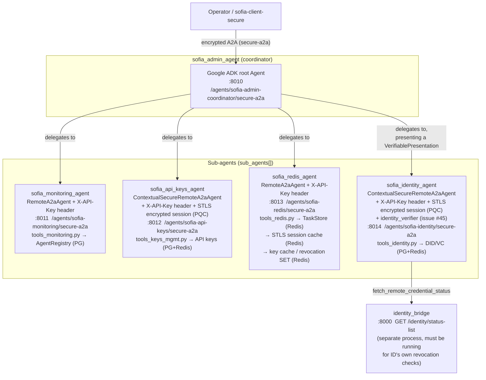

# Sofia Admin — Multi-Agent Administration Example

A Google ADK **coordinator agent** that administers the Sofia Platform by
delegating to four specialized **sub-agents**, each exposed as its own
independent STLS-A2A service. The example demonstrates agent-to-agent
orchestration over A2A, with three different transport-security postures
depending on how sensitive each sub-agent's domain is — up to requiring
the caller to prove its own verifiable identity (issue #45), not just an
API key, for the most sensitive one.

---

## The five agents

| Agent | Role | Port (local) | A2A endpoint |
|---|---|---|---|
| `sofia_admin_agent` (coordinator) | Routes operator requests to the right sub-agent(s) | `8010` | `/agents/sofia-admin-coordinator/secure-a2a` |
| `sofia_monitoring_agent` | Agent/platform health: liveness, capabilities, framework breakdown | `8011` | `/agents/sofia-monitoring/secure-a2a` |
| `sofia_api_keys_agent` | API key lifecycle: create, revoke, update scopes, usage stats | `8012` | `/agents/sofia-api-keys/secure-a2a` |
| `sofia_redis_agent` | Redis internals: A2A task store, STLS session cache, API key cache, revocation set | `8013` | `/agents/sofia-redis/secure-a2a` |
| `sofia_identity_agent` | W3C DID/Verifiable Credential identities: bootstrap/issue/revoke, trust anchors, delegation checks | `8014` | `/agents/sofia-identity/secure-a2a` |

Each agent is its own process with its own `server.py`, `.env`, and
PostgreSQL-backed API key manager (`create_secure_a2a_endpoint` +
`ApiKeyManagerGroup`, from `stls_a2a`) — there is no shared state between
them other than the Postgres/Redis backends they each read from.

- `server/coordinator/` — `agent_coordinator.py` + `server.py`
- `server/monitoring/` — `agent_monitoring.py` + `tools_monitoring.py` + `server.py`
- `server/keys_management/` — `agent_keys_management.py` + `tools_keys_management.py` + `server.py`
- `server/redis/` — `agent_redis.py` + `tools_redis.py` + `server.py`
- `server/identity_manager/` — `agent_identity.py` + `tools_identity.py` + `server.py`
  (plus `bootstrap_coordinator_identity.py`, see
  [Identity-compliant sub-agents](#identity-compliant-sub-agents-issue-45) below)

> `identity_bridge/`, `identity_trust_registry/` and `operator-b/` in this
> same sample folder belong to a separate, standalone identity-federation
> example (publishing DID Documents/status lists for external verifiers,
> cross-platform trust anchors) — **not** part of the coordinator/sub-agent
> flow described here, with one exception: `identity_bridge` must be
> running for `sofia_identity_agent`'s own revocation checks to succeed
> (see below). `identity_manager/` itself now serves double duty: the
> standalone conversational identity example it always was, *and* the
> coordinator's 4th sub-agent.

---

## Architecture



---

## How the A2A interaction works

The coordinator is a plain Google ADK `Agent` whose `sub_agents=[...]` list
holds four **remote** A2A agents. At startup/first call, ADK fetches each
sub-agent's agent card from `{BASE_URL_*}/.well-known/agent-card.json`
(`AGENT_CARD_WELL_KNOWN_PATH`), learns its skills, and routes the LLM's tool
calls to it as standard A2A `messages/send` requests over HTTP. From the
coordinator's point of view, each sub-agent is just a URL plus a client:

```python
sofia_redis_agent = RemoteA2aAgent(
    agent_card=f"{BASE_URL_REDIS}{AGENT_CARD_WELL_KNOWN_PATH}",
    httpx_client=httpx.AsyncClient(headers={"X-API-Key": API_KEY_REDIS}, ...),
)

sofia_api_keys_agent = ContextualSecureRemoteA2aAgent(
    agent_card=f"{BASE_URL_API_KEYS}{AGENT_CARD_WELL_KNOWN_PATH}",
    extra_headers={"X-API-Key": API_KEY_API_KEYS},
    context_keys=[],
)
```

The system prompt in `agent_coordinator.py` gives the LLM explicit routing
hints ("which agents are running" → monitoring, "create/revoke keys" →
api-keys, "tasks"/"cache entries" → redis, "identity/DID/VC/trust anchors" →
identity), plus a rule to coordinate both `sofia_api_keys_agent` and
`sofia_redis_agent` for cross-domain questions such as "is the key for
agent X still cached in Redis?".

### Three transport-security postures, by design

All four sub-agents sit behind `create_secure_a2a_endpoint`, so every call
is authenticated with a per-agent static `X-API-Key` (issued and checked via
each sub-agent's own `PostgresLoader` + `ApiKeyManager`). On top of that,
**two sub-agents get an extra layer**: `sofia_api_keys_agent`, because it is
the one that creates, reads and revokes the credentials every other agent
relies on, and `sofia_identity_agent` — the most sensitive one on the
platform (bootstraps/issues/revokes identities, onboards trust anchors) —
which additionally requires the caller to prove its *own* verifiable
identity, not just present a static key (issue #15/#45):

| | `sofia_monitoring_agent` / `sofia_redis_agent` | `sofia_api_keys_agent` | `sofia_identity_agent` |
|---|---|---|---|
| ADK wrapper | `RemoteA2aAgent` | `ContextualSecureRemoteA2aAgent` | `ContextualSecureRemoteA2aAgent` |
| Auth | `X-API-Key` header, plain `httpx.AsyncClient` | `X-API-Key` header **+** STLS encrypted session | `X-API-Key` header **+** STLS encrypted session **+** `identity_verifier` |
| Payload encryption | none (relies on transport/network security) | AES-256-GCM over a PQC-derived session key (hybrid X25519 + ML-KEM-768 by default), transparent to the ADK | same as `sofia_api_keys_agent` |
| Session/user context propagation | n/a | supported via `context_keys` (disabled here — `context_keys=[]` — since this sample has no per-user session state to forward) | same (disabled) |
| Identity presentation | n/a | n/a | the coordinator must present a signed `VerifiablePresentation` of its own, verified server-side via `RequestPresentationVerifier` — see [Identity-compliant sub-agents](#identity-compliant-sub-agents-issue-45) |

This mirrors the general STLS-A2A security layering: `create_secure_a2a_endpoint`
on the server side always requires API-key authorization, while the
`SecureA2ATransport` / PQC handshake is the additional encrypted channel used
wherever the payload itself — not just the caller's identity — needs
protection in transit.

### End-to-end call flow

1. An operator (human, or `sofia-client-secure`) sends a message to the
   coordinator's `/agents/sofia-admin-coordinator/secure-a2a` endpoint.
2. The coordinator's LLM decides, from the routing hints, which sub-agent(s)
   the request needs.
3. For each selected sub-agent, ADK issues an A2A `messages/send` call to
   that agent's own `secure-a2a` endpoint, carrying the sub-agent's
   `X-API-Key` (and, for `sofia_api_keys_agent`/`sofia_identity_agent`, an
   STLS-encrypted payload). For `sofia_identity_agent`, if
   `REQUIRE_IDENTITY_PRESENTATION=true` there, the first call on a session
   gets `ERR_IDENTITY_CHALLENGE_REQUIRED` back with a fresh challenge;
   `STLSHttpxTransport` signs a `VerifiablePresentation` over it
   (`identity_challenge_handler`) and retries automatically, exactly once —
   transparent to the ADK layer.
4. The sub-agent's `SecureA2AHTTPMiddleware` authenticates the key, decrypts
   the payload where applicable, verifies the identity presentation where
   configured, and dispatches to its own ADK `Agent` and tools
   (`tools_monitoring.py`, `tools_keys_management.py`, `tools_redis.py`,
   `tools_identity.py`).
5. The sub-agent's tool reads/writes its backing store (Postgres for agent
   registry/API keys, Redis for task store/session cache/key cache) and
   returns a completed A2A `Task` with its result as an artifact.
6. The coordinator aggregates the sub-agent response(s) into its own reply
   to the operator. For cross-domain questions it repeats steps 2–5 against
   more than one sub-agent before answering.

---

## Running locally

Start the four sub-agents first (any order), then the coordinator — each
reads its peer's URL from its own `.env`:

```bash
# from each directory, in any order
cd server/monitoring      && python3 server.py   # :8011
cd server/keys_management && python3 server.py   # :8012
cd server/redis           && python3 server.py   # :8013
cd server/identity_manager && python3 server.py  # :8014

# last — it resolves BASE_URL_MONITORING / BASE_URL_API_KEYS / BASE_URL_REDIS / BASE_URL_IDENTITY
cd server/coordinator     && python3 server.py   # :8010
```

Each `.env` already points `BASE_URL_*` at `localhost:801{1,2,3,4}` for local
development; set `API_KEY_REDIS` / `API_KEY_API_KEYS` / `API_KEY_MONITORING` /
`API_KEY_IDENTITY` in `server/coordinator/.env` to API keys issued by each
sub-agent's own Postgres-backed key store.

By default `identity_manager`'s `REQUIRE_IDENTITY_PRESENTATION=false`, so
`sofia_identity_agent` behaves exactly like the other three sub-agents —
nothing above needs the identity-specific setup until you want to exercise
it. See [Identity-compliant sub-agents](#identity-compliant-sub-agents-issue-45)
for that.

---

## Identity-compliant sub-agents ([issue #45](https://github.com/sparkle-stls-ai/stls-ai/issues/45))

Follow-up to [issue #15](https://github.com/sparkle-stls-ai/stls-ai/issues/15)
gap #1 (the `X-STLS-Identity-Presentation` wire format, see
[`python/stls-identity`](../../../python/stls-identity)'s own README):
applying the `identity_verifier`/`identity_challenge_handler` mechanism
built there to a real platform, not just the standalone
[`19_identity_presentation`](../19_identity_presentation) sample.

### Why `sofia_identity_agent`

Among the four sub-agents, `identity_manager` was the only one with
`api_key_manager` commented out in its `server.py` — unauthenticated,
despite being the most sensitive one (it bootstraps/issues/revokes
identities for every other agent, and onboards trust anchors). Issue #45
closes that gap in two steps: re-enabling `api_key_manager` (parity with
its siblings), and additionally requiring the caller to prove its own
verifiable identity — not just present a static key — since managing
identities is exactly the kind of operation that should itself require one.

### The coordinator's identity is resolved dynamically, not from a file

The coordinator (the Requestor) and `identity_manager` (the Verifier) both
read from the **same** persistent stores `tools_identity.py` already
maintains:

- the identity **keystore** (Redis-backed `IdentityKeystoreBase`) — holds
  the coordinator's own Ed25519 private key, written once by
  `bootstrap_agent_identity`.
- the **credential cache** (Redis, same key format as
  `cache_own_identity_credential`/`get_cached_identity_credential`) — holds
  the coordinator's current `NetworkAuthorityCredential`, written every
  time `issue_identity_credential_for_agent` runs (it always caches what it
  issues now — see below).
- the **DID store** (Postgres) — `identity_manager`'s own
  `_build_identity_verifier()` resolves the coordinator's public key from
  there at startup, inside the FastAPI `lifespan` (the real uvicorn event
  loop — see the code comment in `identity_manager/server.py` for why that
  ordering matters).

Nothing is cached in a one-shot local file. Whichever path bootstraps or
re-issues the coordinator's identity — the standalone
`bootstrap_coordinator_identity.py` script, or just asking
`sofia_identity_agent` in chat to `bootstrap_agent_identity` /
`issue_identity_credential_for_agent` — ends up in these same stores, so
`agent_coordinator.py` always picks up the latest one on its next restart,
regardless of which path was used.

`issue_identity_credential_for_agent` **always** auto-caches the credential
it issues (not just "offered" by the agent's own instruction and left to
whether the user accepts) — this is what makes the chat path and the
script path converge on the same source of truth.

### Setting it up

1. **Start `identity_bridge`** too (a 5th process, separate from the four
   sub-agents) — `sofia_identity_agent`'s own revocation check
   (`fetch_remote_credential_status`, from `stls-identity`) fetches the
   status list it publishes over HTTP:

   ```bash
   cd server/identity_bridge
   uv run uvicorn run_identity_bridge:app --reload --port 8000
   # or: python run_identity_bridge.py (reads IDENTITY_BRIDGE_PORT from .env.identity_bridge, default 8000)
   ```

2. **Bootstrap the coordinator's identity** — either run the script once:

   ```bash
   cd server/identity_manager
   python bootstrap_coordinator_identity.py
   ```

   or ask `sofia_identity_agent` in chat to do the same two steps
   (`bootstrap_agent_identity` then `issue_identity_credential_for_agent`,
   agent_id `sofia-admin-coordinator`) — both end up in the same stores.

3. **Set `REQUIRE_IDENTITY_PRESENTATION=true`** in
   `identity_manager/.env`, restart `identity_manager`.

4. **Restart the coordinator** too — module-level Python state (the
   `_coordinator_presenter` built from the keystore/cache at import time)
   is only re-read on process start.

5. Chat with `sofia-admin` and ask something identity-related (or
   anything — the coordinator's own instruction routes identity questions
   to `sofia_identity_agent`). The first call on a fresh session gets the
   automatic challenge/retry; it should otherwise be invisible.

### Troubleshooting

Each of these was hit (and fixed, or explained) while building this —
listed in the order you're likely to encounter them:

| Symptom (server log) | Cause | Fix |
|---|---|---|
| `ApiKeyManager auth denied ... invalid` | `API_KEY_IDENTITY` in `coordinator/.env` doesn't match a real key provisioned via `sofia_api_keys_agent`/Postgres | Provision a real key for `sofia-identity`, set it in `coordinator/.env` |
| `Identity challenge issued` then immediately a 401 | `identity_challenge_handler` is `None` — either because the coordinator genuinely isn't bootstrapped yet, **or** because it is, but `coordinator/.env` is missing `IDENTITY_CREDENTIAL_CACHE_BACKEND=redis` (defaults to `"memory"`, a fresh empty per-process cache, so `load_identity_presenter()` never finds the credential `bootstrap_coordinator_identity.py` already cached in Redis) — hit for real after merging #45, same symptom either way | Run step 2 above; if already bootstrapped, check `coordinator/.env` has `IDENTITY_CREDENTIAL_CACHE_BACKEND=redis` (see `env.example`), then restart the coordinator |
| `unknown or untrusted holder verification method` | The coordinator's DID Document was found... or wasn't — this exact message also came from a real bug (see below): `_build_identity_verifier()` resolved the coordinator's key with a throwaway `asyncio.run()` call *before* `uvicorn.run()` started the real event loop, poisoning `tools_identity._deps()`'s cached asyncpg pool for the rest of the process (silently breaking every later `did_store.get()` call). Fixed by moving that resolution into the FastAPI `lifespan` instead. If you still see this after restarting with the fix: check the startup log for `Identity verifier: trusted coordinator key loaded (...)` — its absence means the coordinator genuinely isn't bootstrapped yet (step 2) |
| `presentation signature verification failed` (right after an `unknown holder` cycle) | Almost certainly a stale, long-running `coordinator` process still signing with code loaded before a fix landed (Python doesn't hot-reload) | Restart **both** `identity_manager` and `coordinator` |
| `identity_verifier.verify_request() error: All connection attempts failed` → 503 | `identity_bridge` isn't running — `fetch_remote_credential_status` can't reach the status-list URL embedded in the credential | Start `identity_bridge` (step 1 above) |
| `validate_operational_credential`/`validate_external_operational_credential` (external case): `unknown or untrusted verification method` for the Grantor's own key | Found while testing #48's delegation flows: `tools_identity.py`'s shared `d.sentinel` only ever held the Governing Authority's key — correct for a plain Identity Credential, but an Operational Credential is signed by the **Grantor**, not the Authority, and `Sentinel.verify_signature()` does no automatic DID-document resolution by design. The internal case (`validate_operational_credential`) never resolved the Grantor's key the way the external case already did | Fixed in both `identity_manager/tools_identity.py` and `operator-b/identity_manager/tools_identity.py` — the internal case now also resolves the Grantor's key from `did_store` before verifying |
| `validate_external_operational_credential`/`validate_external_identity_credential`: `signature verification failed` for the external Grantor's own identity, even with the right code | The onboarded Trust Anchor Registry key for the external Authority is stale — its signing key drifted (e.g. a Redis reset on its keystore DB) since the DID Document was last fetched/onboarded | Re-fetch the external Authority's current DID Document and re-run `onboard_trust_anchor` with its current key — `PostgresTrustAnchorRegistryStore.put()` handles this as a rotation automatically, no manual revoke needed first |
| `validate_external_operational_credential` (or any tool taking a large credential as an argument): `signature verification failed`, but the same data passes when validated directly via a script | Found while testing #48: pasting a large JSON credential as chat text makes the conversational agent *regenerate* it as tool-call arguments — a single-character drift anywhere in a long `proofValue` is enough to break RFC 8785 canonicalization, even though the content looks identical to a human. Not a bug in the verification logic | **Attach the credential as a file** instead of pasting it as text — resolved this reliably in testing |
| The sub-agent's error never shows up in the chat UI at all | A real, general bug in `GoogleADKAdapter` (not identity-specific) — `event.is_error()` doesn't exist on `google.adk.events.Event`, so a failing sub-agent's error was silently dropped. Fixed in `stls_a2a_google_adapter.py` (see issue #45's GitHub comments for the full writeup) | Update `stls_a2a` to a version including that fix |

### Known limitation

`fetch_remote_credential_status`'s revocation check is a real HTTP fetch
per verification, no caching — fine for this sample, but a production
deployment presenting many identity-checked calls per second would want a
caching layer in front of it (the same MRI-bounded freshness window
`Sentinel`/`StatusListManager` already assume elsewhere).

### Testing delegation ([issue #48](https://github.com/sparkle-stls-ai/stls-ai/issues/48))

`tools_identity.py` deliberately never issues an Operational Credential
itself (see its own docstring, and [issue #51](https://github.com/sparkle-stls-ai/stls-ai/issues/51)
for the open design question of whether that should ever change) — only
`validate_operational_credential`/`validate_external_operational_credential`
are exposed as tools. To produce a real delegation to validate:

- `identity_manager/bootstrap_grantor_delegation.py` — internal Grantor
  (bootstraps `grantor-demo`/`requestor-demo`, issues a real Operational
  Credential via `DelegationManager` directly, prints what to feed into
  `validate_operational_credential`).
- `operator-b/identity_manager/bootstrap_grantor_delegation.py` — same,
  for the external-Grantor case (`operator-b` as the other platform).
- `operator-b/identity_manager/dump_external_delegation_fixture.py` +
  `identity_manager/run_external_delegation_fixture.py` — paired
  scripts that test `validate_external_operational_credential`
  end to end in-process, no chat round trip — see the troubleshooting
  table above for why that matters with large credentials.
- `operator-b/identity_manager/revoke_grantor_identity.py` — revokes
  the external Grantor's Identity Credential directly (`operator-b` has
  no chat UI of its own).

All four write into real Postgres/Redis, same posture as
`bootstrap_coordinator_identity.py` — run them yourself, not something
this sample runs automatically.

---

## Testing through sofia-client-secure

This example can be exercised end-to-end from
[`samples/client/sofia-client-secure`](../../client/sofia-client-secure) — a
React + Express chat client built specifically for agents that expose
encrypted transport. To point it at this coordinator:

1. Start `sofia-client-secure` (Python secure-transport service, Express
   backend, React dev server — see its own README).
2. Register the coordinator in `sf_agents_config`:

   ```sql
   INSERT INTO sf_agents_config (agent_name, url, api_key)
   VALUES ('sofia-admin', 'http://localhost:8010/agents/sofia-admin-coordinator/secure-a2a', '<coordinator API key>');
   ```

3. Grant a user access to it via `sf_agents_access` (optionally with a
   `profile` JSON payload).
4. Chat with `sofia-admin` from the UI — every message is routed through
   the coordinator exactly as described above, and the client's "secure"
   proxy path is what lets you drive `sofia_api_keys_agent`'s PQC-encrypted
   leg of the conversation without any special handling on the frontend.

---

## Deploying to Cloud Run

[`deploy/gcp`](deploy/gcp) provisions **three of the four sub-agents** on
Cloud Run (Cloud SQL Postgres, Memorystore Redis, Artifact Registry, Secret
Manager) — see its own README for the full Terraform layout. The
coordinator is not part of that Terraform module; it is meant to run
wherever the operator client lives (locally, or as a separate deployment
you add yourself), resolving `BASE_URL_MONITORING` / `BASE_URL_API_KEYS` /
`BASE_URL_REDIS` to the Cloud Run URLs of the three deployed services.
`identity_manager` (and `identity_bridge`) are not part of this module
either — add them yourself the same way if you need issue #45's identity
enforcement in a deployed environment, not just locally.
