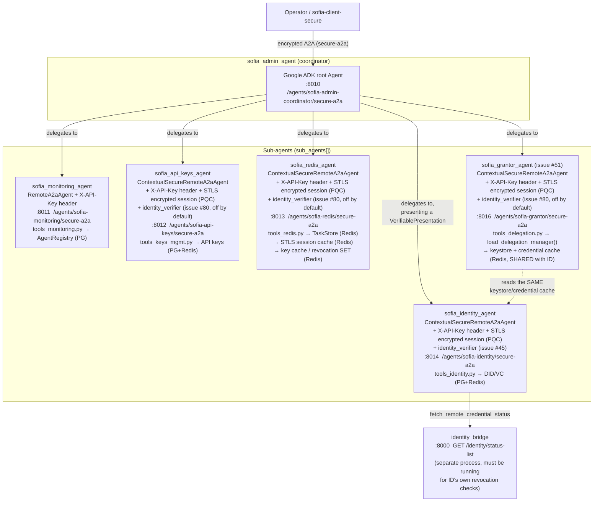

# Sofia Admin — Multi-Agent Administration Example

A Google ADK **coordinator agent** that administers the Sofia Platform by
delegating to specialized **sub-agents**, each exposed as its own
independent STLS-A2A service. The example demonstrates agent-to-agent
orchestration over A2A, with two transport-security postures: one
sub-agent (`sofia_monitoring_agent`) stays plain (API key only), and
every other sub-agent — plus the coordinator's own endpoint — sits
behind an encrypted STLS session and can additionally require the
caller to prove its own verifiable identity (issue #15/#45/#80), not
just an API key, via the same `REQUIRE_IDENTITY_PRESENTATION` switch on
each one.

---

## The six agents

| Agent | Role | Port (local) | A2A endpoint |
|---|---|---|---|
| `sofia_admin_agent` (coordinator) | Routes operator requests to the right sub-agent(s) | `8010` | `/agents/sofia-admin-coordinator/secure-a2a` |
| `sofia_monitoring_agent` | Agent/platform health: liveness, capabilities, framework breakdown | `8011` | `/agents/sofia-monitoring/secure-a2a` |
| `sofia_api_keys_agent` | API key lifecycle: create, revoke, update scopes, usage stats | `8012` | `/agents/sofia-api-keys/secure-a2a` |
| `sofia_redis_agent` | Redis internals: A2A task store, STLS session cache, API key cache, revocation set | `8013` | `/agents/sofia-redis/secure-a2a` |
| `sofia_identity_agent` | W3C DID/Verifiable Credential identities: bootstrap/issue/revoke, trust anchors, delegation checks | `8014` | `/agents/sofia-identity/secure-a2a` |
| `sofia_grantor_agent` | Issues real delegations (Operational Credentials) under its own Grantor identity — issue #51 | `8016` | `/agents/sofia-grantor/secure-a2a` |

Each agent is its own process with its own `server.py`, `.env`, and
PostgreSQL-backed API key manager (`create_secure_a2a_endpoint` +
`ApiKeyManagerGroup`, from `stls_a2a`) — there is no shared state between
them other than the Postgres/Redis backends they each read from.

- `server/coordinator/` — `agent_coordinator.py` + `server.py`
- `server/monitoring/` — `agent_monitoring.py` + `tools_monitoring.py` + `server.py`
- `server/keys_management/` — `agent_keys_management.py` + `tools_keys_management.py` + `server.py`
- `server/redis/` — `agent_redis.py` + `tools_redis.py` + `server.py`
- `server/identity_manager/` — `agent_identity.py` + `tools_identity.py` + `server.py`
  (plus `bootstrap_coordinator_identity.py`, see
  [Identity-compliant sub-agents](#identity-compliant-sub-agents-issue-45) below)
- `server/grantor_agent/` — `agent_grantor.py` + `tools_delegation.py` + `server.py` — generic,
  configured entirely via `IDENTITY_AGENT_ID` (one running copy = one specific
  Grantor); see [Delegation with a real Grantor agent](#delegation-with-a-real-grantor-agent-issue-51) below

> `identity_bridge/`, `identity_trust_registry/` and `operator-b/` in this
> same sample folder belong to a separate, standalone identity-federation
> example (publishing DID Documents/status lists for external verifiers,
> cross-platform trust anchors) — **not** part of the coordinator/sub-agent
> flow described here, with one exception: `identity_bridge` must be
> running for `sofia_identity_agent`'s own revocation checks to succeed
> (see below). `identity_manager/` itself now serves double duty: the
> standalone conversational identity example it always was, *and* the
> coordinator's 4th sub-agent — and so does `operator-b/`, which now also
> hosts its own `grantor_agent/` deployment (issue #51's inter-operator
> scenario, see [Delegation with a real Grantor agent](#delegation-with-a-real-grantor-agent-issue-51)).

---

## Architecture



---

## How the A2A interaction works

The coordinator is a plain Google ADK `Agent` whose `sub_agents=[...]` list
holds five **remote** A2A agents. At startup/first call, ADK fetches each
sub-agent's agent card from `{BASE_URL_*}/.well-known/agent-card.json`
(`AGENT_CARD_WELL_KNOWN_PATH`), learns its skills, and routes the LLM's tool
calls to it as standard A2A `messages/send` requests over HTTP. From the
coordinator's point of view, each sub-agent is just a URL plus a client:

```python
sofia_monitoring_agent = RemoteA2aAgent(
    agent_card=f"{BASE_URL_MONITORING}{AGENT_CARD_WELL_KNOWN_PATH}",
    httpx_client=httpx.AsyncClient(headers={"X-API-Key": API_KEY_MONITORING}, ...),
)

sofia_api_keys_agent = ContextualSecureRemoteA2aAgent(
    agent_card=f"{BASE_URL_API_KEYS}{AGENT_CARD_WELL_KNOWN_PATH}",
    extra_headers={"X-API-Key": API_KEY_API_KEYS},
    context_keys=[],
    identity_challenge_handler=_identity_challenge_handler,
)
```

The system prompt in `agent_coordinator.py` gives the LLM explicit routing
hints ("which agents are running" → monitoring, "create/revoke keys" →
api-keys, "tasks"/"cache entries" → redis, "identity/DID/VC/trust anchors" →
identity, "grant/authorize/delegate a permission" → grantor), plus a rule
to coordinate both `sofia_api_keys_agent` and `sofia_redis_agent` for
cross-domain questions such as "is the key for agent X still cached in
Redis?".

### Two transport-security postures, by design

All five sub-agents sit behind `create_secure_a2a_endpoint`, so every call
is authenticated with a per-agent static `X-API-Key` (issued and checked via
each sub-agent's own `PostgresLoader` + `ApiKeyManager`). On top of that,
**every sub-agent except `sofia_monitoring_agent`** goes over an encrypted
STLS session (`ContextualSecureRemoteA2aAgent`) and can additionally
require the caller to prove its *own* verifiable identity, not just present
a static key (issue #15/#45, generalized to every secure sub-agent by
issue #80):

| | `sofia_monitoring_agent` | `sofia_api_keys_agent` / `sofia_redis_agent` / `sofia_identity_agent` / `sofia_grantor_agent` |
|---|---|---|
| ADK wrapper | `RemoteA2aAgent` | `ContextualSecureRemoteA2aAgent` |
| Auth | `X-API-Key` header, plain `httpx.AsyncClient` | `X-API-Key` header **+** STLS encrypted session |
| Payload encryption | none (relies on transport/network security) | AES-256-GCM over a PQC-derived session key (hybrid X25519 + ML-KEM-768 by default), transparent to the ADK |
| Session/user context propagation | n/a | supported via `context_keys` (disabled here — `context_keys=[]` — since this sample has no per-user session state to forward) |
| Identity presentation | n/a | optional, per sub-agent, via that sub-agent's own `REQUIRE_IDENTITY_PRESENTATION` — off by default for all four. When on, the coordinator must present a signed `VerifiablePresentation` of its own, verified server-side via `stls_identity.request_presentation_verifier_from_env()`. The sub-agent's plain endpoint stays reachable regardless (closing it via `enable_plain_endpoint=False` is left for later — see [Identity-compliant sub-agents](#identity-compliant-sub-agents-issue-45)) |

Each of the four secure sub-agents' own `identity_verifier` is wired
identically — same `request_presentation_verifier_from_env()` call, same
`REQUIRE_IDENTITY_PRESENTATION` switch, same Governing Authority trust
anchor — so flipping it on for `sofia_api_keys_agent` or
`sofia_grantor_agent` needs no code change, only their own `.env`.
`sofia_identity_agent` is simply the one this was first built and tested
against (issue #45, the most sensitive sub-agent on the platform); the
other three had never had any identity check at all until issue #80 closed
that parity gap — see
[Delegation with a real Grantor agent](#delegation-with-a-real-grantor-agent-issue-51)
for `sofia_grantor_agent`'s own authorization story on top of this.

This mirrors the general STLS-A2A security layering: `create_secure_a2a_endpoint`
on the server side always requires API-key authorization, while the
`SecureA2ATransport` / PQC handshake is the additional encrypted channel used
wherever the payload itself — not just the caller's identity — needs
protection in transit.

### End-to-end call flow

1. An operator (human, or `sofia-client-secure`) sends a message to the
   coordinator's `/agents/sofia-admin-coordinator/secure-a2a` endpoint.
2. The coordinator's LLM decides, from the routing hints, which sub-agent(s)
   the request needs.
3. For each selected sub-agent, ADK issues an A2A `messages/send` call to
   that agent's own `secure-a2a` endpoint, carrying the sub-agent's
   `X-API-Key` and, for every sub-agent except `sofia_monitoring_agent`, an
   STLS-encrypted payload. If that sub-agent's own
   `REQUIRE_IDENTITY_PRESENTATION=true`, the first call on a session gets
   `ERR_IDENTITY_CHALLENGE_REQUIRED` back with a fresh challenge;
   `STLSHttpxTransport` signs a `VerifiablePresentation` over it
   (`identity_challenge_handler`) and retries automatically, exactly once —
   transparent to the ADK layer.
4. The sub-agent's `SecureA2AHTTPMiddleware` authenticates the key, decrypts
   the payload where applicable, verifies the identity presentation where
   configured, and dispatches to its own ADK `Agent` and tools
   (`tools_monitoring.py`, `tools_keys_management.py`, `tools_redis.py`,
   `tools_identity.py`).
5. The sub-agent's tool reads/writes its backing store (Postgres for agent
   registry/API keys, Redis for task store/session cache/key cache) and
   returns a completed A2A `Task` with its result as an artifact.
6. The coordinator aggregates the sub-agent response(s) into its own reply
   to the operator. For cross-domain questions it repeats steps 2–5 against
   more than one sub-agent before answering.

---

## Running locally

Start the five sub-agents first (any order), then the coordinator — each
reads its peer's URL from its own `.env`:

```bash
# from each directory, in any order
cd server/monitoring       && python3 server.py   # :8011
cd server/keys_management  && python3 server.py   # :8012
cd server/redis            && python3 server.py   # :8013
cd server/identity_manager && python3 server.py   # :8014
cd server/grantor_agent    && python3 server.py   # :8016

# last — it resolves BASE_URL_MONITORING / BASE_URL_API_KEYS / BASE_URL_REDIS /
# BASE_URL_IDENTITY / BASE_URL_GRANTOR
cd server/coordinator      && python3 server.py   # :8010
```

Each `.env` already points `BASE_URL_*` at `localhost:801{1,2,3,4,6}` for
local development; set `API_KEY_REDIS` / `API_KEY_API_KEYS` /
`API_KEY_MONITORING` / `API_KEY_IDENTITY` / `API_KEY_GRANTOR` in
`server/coordinator/.env` to API keys issued by each sub-agent's own
Postgres-backed key store.

By default every secure sub-agent's own `REQUIRE_IDENTITY_PRESENTATION=false`,
so `sofia_api_keys_agent`/`sofia_redis_agent`/`sofia_identity_agent`/
`sofia_grantor_agent` all behave exactly like `sofia_monitoring_agent` (API
key only) — nothing above needs the identity-specific setup until you want
to exercise it. See [Identity-compliant sub-agents](#identity-compliant-sub-agents-issue-45)
for that.

---

## Identity-compliant sub-agents ([issue #45](https://github.com/sparkle-stls-ai/stls-ai/issues/45) / [issue #80](https://github.com/sparkle-stls-ai/stls-ai/issues/80))

Follow-up to [issue #15](https://github.com/sparkle-stls-ai/stls-ai/issues/15)
gap #1 (the `X-STLS-Identity-Presentation` wire format, see
[`python/stls-identity`](../../../python/stls-identity)'s own README):
applying the `identity_verifier`/`identity_challenge_handler` mechanism
built there to a real platform, not just the standalone
[`19_identity_presentation`](../19_identity_presentation) sample.

### Why `sofia_identity_agent` first, then every secure sub-agent

Among the four secure sub-agents, `identity_manager` was the only one with
`api_key_manager` commented out in its `server.py` — unauthenticated,
despite being the most sensitive one (it bootstraps/issues/revokes
identities for every other agent, and onboards trust anchors). Issue #45
closed that gap in two steps: re-enabling `api_key_manager` (parity with
its siblings), and additionally requiring the caller to prove its own
verifiable identity — not just present a static key — since managing
identities is exactly the kind of operation that should itself require one.

Issue #80 generalized the second half of that to `sofia_api_keys_agent`,
`sofia_redis_agent` and `sofia_grantor_agent` too. Along the way, a
concrete gap was found: none of the four secure sub-agents' own
`create_secure_a2a_endpoint()` call passed `enable_plain_endpoint`, so
their plain, unencrypted endpoint stays reachable with **no** identity
check even once `REQUIRE_IDENTITY_PRESENTATION=true` locks down the
secure one — same gap the coordinator's own endpoint has (see
[Gating the coordinator's own endpoint](#gating-the-coordinators-own-endpoint-issue-42-follow-up)
below). `create_secure_a2a_endpoint()`/`create_secure_mcp_app()` now
support `enable_plain_endpoint=False` for exactly this (plus the
symmetric `enable_secure_endpoint`, issue #80's own library change —
see [`python/stls-a2a`](../../../python/stls-a2a)'s and
[`python/stls-mcp`](../../../python/stls-mcp)'s own CHANGELOGs), but
none of this sample's `server.py` files pass it yet: the plain endpoint
is left reachable everywhere, by explicit choice, until closing it is
revisited.

### The coordinator's identity is resolved dynamically, not from a file

The coordinator (the Requestor) and each secure sub-agent (the Verifier)
both read from the **same** persistent stores `tools_identity.py` already
maintains:

- the identity **keystore** (Redis-backed `IdentityKeystoreBase`) — holds
  the coordinator's own Ed25519 private key, written once by
  `bootstrap_agent_identity`.
- the **credential cache** (Redis, same key format as
  `cache_own_identity_credential`/`get_cached_identity_credential`) — holds
  the coordinator's current `NetworkAuthorityCredential`, written every
  time `issue_identity_credential_for_agent` runs (it always caches what it
  issues now — see below).
- the **DID store** (Postgres) — `keys_management`/`redis`/`grantor_agent`'s
  own `server.py` each resolve the coordinator's public key from there via
  `stls_identity.request_presentation_verifier_from_env()` (issue #80) —
  one call, generically trusting whichever caller's own DID Document
  resolves under `make_did_document_holder_key_resolver()`, no per-caller
  key to pre-populate. `coordinator/server.py` now uses the same call for
  its own endpoint (see
  [Gating the coordinator's own endpoint](#gating-the-coordinators-own-endpoint-issue-42-follow-up)
  below). `identity_manager/server.py` keeps its own, slightly different
  hand-rolled version (`_build_identity_verifier()` +
  `_populate_coordinator_key()`, a lifespan-deferred step resolving the
  coordinator's key specifically) — already proven end to end for issue
  #45 before #80 existed, left as is rather than risk regressing the one
  identity path that's been live the longest.

Nothing is cached in a one-shot local file. Whichever path bootstraps or
re-issues the coordinator's identity — the standalone
`bootstrap_coordinator_identity.py` script, or just asking
`sofia_identity_agent` in chat to `bootstrap_agent_identity` /
`issue_identity_credential_for_agent` — ends up in these same stores, so
`agent_coordinator.py` always picks up the latest one on its next restart,
regardless of which path was used.

`issue_identity_credential_for_agent` **always** auto-caches the credential
it issues (not just "offered" by the agent's own instruction and left to
whether the user accepts) — this is what makes the chat path and the
script path converge on the same source of truth.

### Setting it up

1. **Start `identity_bridge`** too (a 5th process, separate from the four
   sub-agents) — `sofia_identity_agent`'s own revocation check
   (`fetch_remote_credential_status`, from `stls-identity`) fetches the
   status list it publishes over HTTP:

   ```bash
   cd server/identity_bridge
   uv run uvicorn run_identity_bridge:app --reload --port 8000
   # or: python run_identity_bridge.py (reads IDENTITY_BRIDGE_PORT from .env.identity_bridge, default 8000)
   ```

2. **Bootstrap the coordinator's identity** — either run the script once:

   ```bash
   cd server/identity_manager
   python bootstrap_coordinator_identity.py
   ```

   or ask `sofia_identity_agent` in chat to do the same two steps
   (`bootstrap_agent_identity` then `issue_identity_credential_for_agent`,
   agent_id `sofia-admin-coordinator`) — both end up in the same stores.

3. **Set `REQUIRE_IDENTITY_PRESENTATION=true`** in
   `identity_manager/.env`, restart `identity_manager`.

4. **Restart the coordinator** too — module-level Python state (the
   `_coordinator_presenter` built from the keystore/cache at import time)
   is only re-read on process start.

5. Chat with `sofia-admin` and ask something identity-related (or
   anything — the coordinator's own instruction routes identity questions
   to `sofia_identity_agent`). The first call on a fresh session gets the
   automatic challenge/retry; it should otherwise be invisible.

### Troubleshooting

Each of these was hit (and fixed, or explained) while building this —
listed in the order you're likely to encounter them:

| Symptom (server log) | Cause | Fix |
|---|---|---|
| `ApiKeyManager auth denied ... invalid` | `API_KEY_IDENTITY` in `coordinator/.env` doesn't match a real key provisioned via `sofia_api_keys_agent`/Postgres | Provision a real key for `sofia-identity`, set it in `coordinator/.env` |
| `Identity challenge issued` then immediately a 401 | `identity_challenge_handler` is `None` — either because the coordinator genuinely isn't bootstrapped yet, **or** because it is, but `coordinator/.env` is missing `IDENTITY_CREDENTIAL_CACHE_BACKEND=redis` (defaults to `"memory"`, a fresh empty per-process cache, so `load_identity_presenter()` never finds the credential `bootstrap_coordinator_identity.py` already cached in Redis) — hit for real after merging #45, same symptom either way | Run step 2 above; if already bootstrapped, check `coordinator/.env` has `IDENTITY_CREDENTIAL_CACHE_BACKEND=redis` (see `env.example`), then restart the coordinator |
| `unknown or untrusted holder verification method` | The coordinator's DID Document was found... or wasn't — this exact message also came from a real bug (see below): `_build_identity_verifier()` resolved the coordinator's key with a throwaway `asyncio.run()` call *before* `uvicorn.run()` started the real event loop, poisoning `tools_identity._deps()`'s cached asyncpg pool for the rest of the process (silently breaking every later `did_store.get()` call). Fixed by moving that resolution into the FastAPI `lifespan` instead. If you still see this after restarting with the fix: check the startup log for `Identity verifier: trusted coordinator key loaded (...)` — its absence means the coordinator genuinely isn't bootstrapped yet (step 2) |
| `presentation signature verification failed` (right after an `unknown holder` cycle) | Almost certainly a stale, long-running `coordinator` process still signing with code loaded before a fix landed (Python doesn't hot-reload) | Restart **both** `identity_manager` and `coordinator` |
| `identity_verifier.verify_request() error: All connection attempts failed` → 503 | `identity_bridge` isn't running — `fetch_remote_credential_status` can't reach the status-list URL embedded in the credential | Start `identity_bridge` (step 1 above) |
| `validate_operational_credential`/`validate_external_operational_credential` (external case): `unknown or untrusted verification method` for the Grantor's own key | Found while testing #48's delegation flows: `tools_identity.py`'s shared `d.sentinel` only ever held the Governing Authority's key — correct for a plain Identity Credential, but an Operational Credential is signed by the **Grantor**, not the Authority, and `Sentinel.verify_signature()` does no automatic DID-document resolution by design. The internal case (`validate_operational_credential`) never resolved the Grantor's key the way the external case already did | Fixed in both `identity_manager/tools_identity.py` and `operator-b/identity_manager/tools_identity.py` — the internal case now also resolves the Grantor's key from `did_store` before verifying |
| `validate_external_operational_credential`/`validate_external_identity_credential`: `signature verification failed` for the external Grantor's own identity, even with the right code | The onboarded Trust Anchor Registry key for the external Authority is stale — its signing key drifted (e.g. a Redis reset on its keystore DB) since the DID Document was last fetched/onboarded | Re-fetch the external Authority's current DID Document and re-run `onboard_trust_anchor` with its current key — `PostgresTrustAnchorRegistryStore.put()` handles this as a rotation automatically, no manual revoke needed first |
| `validate_external_operational_credential` (or any tool taking a large credential as an argument): `signature verification failed`, but the same data passes when validated directly via a script | Found while testing #48: pasting a large JSON credential as chat text makes the conversational agent *regenerate* it as tool-call arguments — a single-character drift anywhere in a long `proofValue` is enough to break RFC 8785 canonicalization, even though the content looks identical to a human. Not a bug in the verification logic | **Attach the credential as a file** instead of pasting it as text — resolved this reliably in testing |
| `validate_operational_credential`/`validate_external_operational_credential`: `unknown or untrusted verification method: ...#key-1`, right after rotating a Grantor's key (`rotate_agent_identity`) — restarting `sofia_grantor_agent` did **not** fix it | A real bug, not a stale-process issue: `grantor_agent/tools_delegation.py`'s `_get_delegation_manager()` never passed `verification_method_id` to `load_delegation_manager()`, which then always defaults to the hardcoded `"{holder_did}#key-1"` — WRONG the moment a rotation closes that key generation, on every fresh start, not just a stale cache | Fixed: `_get_delegation_manager()` now resolves the agent's CURRENT verification method from its DID Document (`PostgresDIDDocumentStore` + `current_verification_method()`) before building the manager. **Any Operational Credential already issued with the stale reference stays invalid** — it was signed with the wrong id, not just cached wrong; issue a new one after restarting `sofia_grantor_agent` with the fix |
| Deployed the fix above, restarted `sofia_grantor_agent`, re-issued an Operational Credential — **still** signed `...#key-1`, no error, no behavior change at all | `IDENTITY_PG_DSN`/`IDENTITY_PG_DID_TABLE` are a NEW requirement this fix introduced for `grantor_agent` specifically (it never needed Postgres before issue #80) — they were added to `grantor_agent/env.example` but, since `.env` itself predates that change and isn't regenerated from the example automatically, the REAL `.env` still didn't have them. `PostgresDIDDocumentStore.get()` fails closed (logs its own `ERROR`, returns `None`) when `IDENTITY_PG_DSN` is empty, so the code silently falls through to the exact same old `"#key-1"` default — looking, from the outside, exactly like the fix did nothing | Added a `WARNING`-level log right at that fallback (`"has no DID Document on record (IDENTITY_PG_DSN=...)"`) so this is diagnosable from the server log instead of guessing. Added the missing `IDENTITY_PG_DSN`/`IDENTITY_PG_DID_TABLE` (SAME Postgres "sofia" database/table as `identity_manager`'s own) to `grantor_agent/.env` — and, for parity/consistency, to `keys_management/.env` and `redis/.env` too, even though those two don't strictly need Postgres yet (`REQUIRE_IDENTITY_PRESENTATION=false` there short-circuits before touching it) |
| Same investigation, a second bug found: a Grantor (or the Authority itself) rotated via `rotate_agent_identity()`, then `identity_manager` (or `operator-b/identity_manager`) restarted — the rotation's closed-key entry silently disappears from the DID Document, as if it never rotated | `bootstrap_agent_identity()` and `_deps()`'s own Authority bootstrap both rebuilt a brand-new, single-verification-method DID Document from whatever key currently sits in the keystore and **unconditionally overwrote** the stored one on every call — i.e. on every process restart (`_deps()` is a once-per-process singleton) and on every re-bootstrap of an already-provisioned agent | Fixed in both `identity_manager/tools_identity.py` and `operator-b/identity_manager/tools_identity.py`: both now check `did_store.get(...)` first and skip the rebuild entirely if a document already exists, in both `bootstrap_agent_identity()` and the Authority's own bootstrap inside `_deps()` |
| `cache_operational_credential`'s own cached copy fails `validate_operational_credential` with `"credential is unsigned"` (`proof` missing), even though `delegate_to_agent` issued it correctly | Extends #48's finding (issue #54): the corruption doesn't need a human paste — it also happens when the chat agent itself re-emits its **own prior tool-call result** as the argument to a *new* tool call (here: `delegate_to_agent`'s JSON output relayed into `cache_operational_credential`). Confirmed via `grantor_agent/dump_delegation_fixture.py` + `identity_manager/run_delegation_fixture.py` (same no-chat-relay-anywhere pattern as #48's own fixture scripts): `proof` survives intact at every stage when chat never touches the credential in between | Same fix as #48 — route large signed credentials through a file or a direct script/A2A call between tool invocations, never through the model re-typing one as another tool's argument |
| The sub-agent's error never shows up in the chat UI at all | A real, general bug in `GoogleADKAdapter` (not identity-specific) — `event.is_error()` doesn't exist on `google.adk.events.Event`, so a failing sub-agent's error was silently dropped. Fixed in `stls_a2a_google_adapter.py` (see issue #45's GitHub comments for the full writeup) | Update `stls_a2a` to a version including that fix |
| `sofia_grantor_agent`: `400 INVALID_ARGUMENT ... Unknown name "additional_properties" at 'tools[0].function_declarations[0].parameters.properties[...].value'` | Found while testing #51: a `dict`-typed tool parameter (tried both bare `dict` and `dict[str, str]`) makes `google-adk` generate a function-declaration schema that Gemini's function-calling API rejects outright — same `google-genai` version this sample already uses successfully elsewhere for other agents' `dict`-typed tool parameters, so this isn't a blanket "dict never works" issue; it reproduced consistently for this specific tool regardless, root cause not fully isolated | Avoid a `dict` parameter type entirely for `delegate_to_agent`'s `scope` — it now takes `scope_json: str` (a JSON-encoded object) and parses it with `json.loads()` inside the tool. A plain string parameter never triggers the problematic schema path |
| `sofia_redis_agent`'s session listing never shows a session for the coordinator's calls to `sofia_identity_agent`/`sofia_grantor_agent` (or any `ContextualSecureRemoteA2aAgent` sub-agent), even with `SESSION_CACHE_BACKEND=redis` set on the coordinator | That env var only wires up the coordinator's **server**-side cache (`SecureA2AHTTPMiddleware.sessions` — sessions where the coordinator is the one being called, e.g. from `sofia-client-secure`). `ContextualSecureRemoteA2aAgent`'s client-side cache (the coordinator calling OUT to a sub-agent) is a plain in-process dict with no Redis backend at all today — see [issue #73](https://github.com/sparkle-stls-ai/stls-ai/issues/73). The session is real (the handshake happened, the call works), it just can't be observed from Redis | Not a bug to fix locally — #73 tracks adding that backend. In the meantime, treat the coordinator's outbound sub-agent sessions as invisible to `sofia_redis_agent`/`redis-cli` by design |

### Known limitation

`fetch_remote_credential_status`'s revocation check is a real HTTP fetch
per verification, no caching — fine for this sample, but a production
deployment presenting many identity-checked calls per second would want a
caching layer in front of it (the same MRI-bounded freshness window
`Sentinel`/`StatusListManager` already assume elsewhere).

### Gating the coordinator's own endpoint ([issue #42](https://github.com/sparkle-stls-ai/stls-ai/issues/42) follow-up)

Same mechanism, one level up: the section above makes the coordinator
prove its identity to `identity_manager`; this makes the coordinator, in
turn, require identity from whoever calls **it** — `samples/client/sofia-client-secure`
today, the only real client in this repo that talks to the coordinator over
`/agents/sofia-admin-coordinator/secure-a2a`.

`coordinator/server.py` builds its own verifier with
`stls_identity.request_presentation_verifier_from_env()` (issue #80 —
the same call `keys_management`/`redis`/`grantor_agent/server.py` now use
for their own endpoints too). It differs from `identity_manager`'s
hand-rolled version in one deliberate way, by design: it never pre-resolves
a specific caller's key into `trusted_issuer_keys` (no lifespan-deferred
step needed at all, unlike `identity_manager`'s `_populate_coordinator_key()`)
— it trusts the Governing Authority's key (to verify an Identity
Credential's issuer signature) and resolves EVERY caller's own holder
key generically, straight from that caller's own DID Document
(`stls_identity.make_did_document_holder_key_resolver()`, issue #42).
There is no fixed roster of expected callers to maintain here, by design:
any agent with a bootstrapped identity can present one — exactly what
`request_presentation_verifier_from_env()` itself does for every sub-agent
it's wired into now.

A concrete gap was found while scoping issue #80: `coordinator/server.py`
never passes `enable_plain_endpoint` either, so its own plain
`/agents/sofia-admin-coordinator/` endpoint stays reachable with no
identity check at all even once `REQUIRE_IDENTITY_PRESENTATION=true` is
set below — same gap every secure sub-agent has. `create_secure_a2a_endpoint()`
supports `enable_plain_endpoint=False` for this (issue #80's own library
change), but it isn't passed here yet, by explicit choice — the plain
channel is left open for now, closing it is a later step.

**Setting it up:**

1. Bootstrap `sofia-client-secure`'s own identity — from `server/identity_manager/`:

   ```bash
   python bootstrap_sofia_client_secure_identity.py
   ```

2. Configure `samples/client/sofia-client-secure/.env` with the matching
   `IDENTITY_AGENT_ID=sofia-client-secure` + the same keystore/credential-cache
   Redis settings as `identity_manager/.env` (see that sample's own README,
   "Identity presentation" section) — restart `secure_transport.py`.

3. Set `REQUIRE_IDENTITY_PRESENTATION=true` and `IDENTITY_PG_DSN` (same
   Postgres as `identity_manager/.env`'s own) in `coordinator/.env`, restart
   the coordinator.

4. Call the coordinator through `sofia-client-secure` as usual — the first
   call on a fresh session gets the automatic challenge/retry
   (`secure_transport.py`'s own `_send_with_identity_retry()`/
   `_stream_with_identity_retry()`), transparent to the Express backend and
   the browser above it.

Any OTHER caller of the coordinator's endpoint without a bootstrapped
identity (or with `REQUIRE_IDENTITY_PRESENTATION=false`, the default) is
unaffected — this gate is additive, same off-by-default posture as every
other piece of issue #15/#45/#42.

### Testing delegation ([issue #48](https://github.com/sparkle-stls-ai/stls-ai/issues/48))

`tools_identity.py` deliberately never issues an Operational Credential
itself (see its own docstring) — resolved by
[issue #51](https://github.com/sparkle-stls-ai/stls-ai/issues/51) as
staying that way permanently (a real `grantor_agent/` deployment does it
instead, see [Delegation with a real Grantor agent](#delegation-with-a-real-grantor-agent-issue-51)
below) — only `validate_operational_credential`/`validate_external_operational_credential`
are exposed as tools here. To produce a real delegation to validate:

- `identity_manager/bootstrap_grantor_delegation.py` — internal Grantor
  (bootstraps `grantor-demo`/`requestor-demo`, issues a real Operational
  Credential via `DelegationManager` directly, prints what to feed into
  `validate_operational_credential`).
- `operator-b/identity_manager/bootstrap_grantor_delegation.py` — same,
  for the external-Grantor case (`operator-b` as the other platform).
- `operator-b/identity_manager/dump_external_delegation_fixture.py` +
  `identity_manager/run_external_delegation_fixture.py` — paired
  scripts that test `validate_external_operational_credential`
  end to end in-process, no chat round trip — see the troubleshooting
  table above for why that matters with large credentials.
- `operator-b/identity_manager/revoke_grantor_identity.py` — revokes
  the external Grantor's Identity Credential directly (`operator-b` has
  no chat UI of its own).
- `grantor_agent/dump_delegation_fixture.py` + `identity_manager/run_delegation_fixture.py`
  (issue #54) — same no-chat-relay pattern, for
  `cache_operational_credential`/`get_cached_operational_credential`/
  `validate_operational_credential`'s own round trip through
  `OperationalCredentialCacheFactory` — confirms a chat-cached credential
  keeps its `proof` intact when nothing in the pipeline goes through the
  model twice.

All six write into real Postgres/Redis, same posture as
`bootstrap_coordinator_identity.py` — run them yourself, not something
this sample runs automatically.

### Resetting identity data

After enough manual testing, `identity_manager/reset_identity_data.py`
and `operator-b/identity_manager/reset_identity_data.py` clear every
identity-specific Postgres table and Redis key for each platform
(DID documents, credential log, keystore, credential cache, status
list; the Trust Anchor Registry too, from the Sparkle-side script
only — it's the same physical table, shared with `operator-b` by
design). Both print exactly what they're about to touch and require
typing `yes` before doing anything; neither ever runs `FLUSHDB` (the
shared Redis DB also holds the task store/API-key cache on this
platform — see the test-fixture incident this project already hit
once for why that distinction matters). Worth running before changing
how the keystore itself persists data (e.g. issue #49's at-rest
encryption) — existing plaintext keys won't decrypt once encryption is
turned on, so start from a clean slate rather than migrate them.

---

## Delegation with a real Grantor agent ([issue #51](https://github.com/sparkle-stls-ai/stls-ai/issues/51))

#48 tested delegation with standalone scripts, deliberately not changing
`identity_manager`'s own provisioning-only boundary (it never calls
`DelegationManager` itself — see its own docstring). This section wires
delegation into the actual coordinator/chat flow instead, via a new,
*separate* sub-agent — `sofia_grantor_agent` — rather than adding a
delegation tool to `identity_manager`.

### Why a separate agent, not a new `identity_manager` tool

Discussed at length in #51: making `identity_manager` able to issue
delegations on behalf of *any* Grantor would mean anyone who can talk to
`sofia_identity_agent` could mint a real permission for any Grantor on the
platform, without that Grantor's own logic being involved at call time.
Different facilities/network segments/business units can have different
human owners who need to control their own delegations independently —
one platform-wide chokepoint doesn't fit that. `sofia_grantor_agent`
resolves this by construction: **it is its own service, with its own API
key, and can only ever act as the ONE Grantor identity it was deployed
as.** "Can talk to this specific Grantor agent" *is* the authorization
check — no extra binding logic needed, consistent with how every other
sub-agent here already has its own independent protection.

### Two concrete scenarios this is built for

- **Intra-platform**: a facility's Grantor (e.g. `grantor-mi1`, representing
  authority over site MI1) is asked, via the coordinator, to "authorize
  agent X to activate cross-connects at facility MI1 for 24 hours" — it
  issues a real Operational Credential with
  `scope={"action": "cross-connect-activate", "facility_code": "MI1"}`.
  Agent X later presents that credential to whatever system performs the
  activation, which validates the chain before acting.
- **Inter-operator (federation)** — the same mechanism #48 already tested
  manually (`validate_external_operational_credential`), now issued live.
  `operator-b/grantor_agent/` is a second deployment of the exact same code
  (`IDENTITY_AGENT_ID=grantor-b-segment`, its own port `8017`, rooted in
  `b.example.com` instead of Sparkle's own Governing Authority), able to
  delegate to one of Sparkle's agents the permission to act on operator-b's
  own network segment.

### How one Grantor agent is generic, not scenario-specific

`grantor_agent/` has no facility/scope baked in anywhere — `IDENTITY_AGENT_ID`
(which identity this process presents and delegates as) and the
`scope_json` object passed to `delegate_to_agent` at call time are both
fully free-form (a JSON-encoded string, not a `dict` parameter — see the
troubleshooting table below for why).
"The MI1 facility Grantor" is just one *deployment* of this same generic
code (one `.env`, one bootstrapped identity) — exactly how `operator-b` is
a second deployment of `identity_manager`'s own code, not a fork of it.

### Setting it up

1. **Provision the Grantor's identity** (administrative, stays on
   `identity_manager` — see #51's resolved design): from
   `identity_manager/`, run
   `python bootstrap_grantor_agent_identity.py grantor-mi1` (pick any
   `agent_id` that identifies what this Grantor is authority *over*, not a
   placeholder). This bootstraps its DID and issues it an Identity
   Credential with `roles=["grantor"]`.
2. **Configure `grantor_agent/.env`** from `grantor_agent/env.example` —
   `IDENTITY_AGENT_ID` must match step 1 exactly, and the keystore/
   credential-cache/status-list variables must point at the SAME Redis as
   `identity_manager`'s own `.env` (shared stores, not a separate keystore
   per Grantor).
3. **Start `grantor_agent/server.py`** — it loads the identity from step 1
   at startup via `stls_identity.load_delegation_manager()` (the same
   primitive #45 built for `load_identity_presenter()`, just loading
   something that can *act* as a Grantor instead of *presenting* an
   identity). It refuses the first `delegate_to_agent` call with a clear
   error if steps 1–2 weren't done first.
4. **Configure `coordinator/.env`** — `BASE_URL_GRANTOR`/`API_KEY_GRANTOR`
   (provision the real key the same way as every other sub-agent's,
   via `sofia_api_keys_agent`/Postgres). Restart the coordinator.
5. Ask the coordinator, via `sofia-client-secure`, to delegate something —
   e.g. *"authorize agent requestor-demo to activate cross-connects at
   facility MI1 for the next 24 hours"*.

### Setting up the inter-operator deployment

Exactly the same steps as above, run under `operator-b/` instead:

1. From `operator-b/identity_manager/`, run
   `python bootstrap_grantor_agent_identity.py grantor-b-segment` (same
   script, copied verbatim — it's generic, nothing Sparkle-specific in it).
2. Configure `operator-b/grantor_agent/.env` from its own `env.example` —
   already defaults to `IDENTITY_AGENT_ID=grantor-b-segment`,
   `GOVERNING_AUTHORITY_HOST=b.example.com`, Redis DB `/1` (not `/0`,
   Sparkle's own), port `8017`.
3. Start `operator-b/grantor_agent/server.py`.
4. This agent isn't wired into Sparkle's coordinator's `sub_agents=[...]`
   — but `sofia-client-secure` can reach **any** agent directly, not only
   the coordinator (see
   [Testing through sofia-client-secure](#testing-through-sofia-client-secure)
   below). Two ways to do that, no coordinator involved either way:
   - **Debug mode** (`VITE_MODE=debug`, the simplest for a one-off test
     like this): `sofia-client-secure`'s `/api/proxy/direct/send`/`/stream`
     take the agent's `url` and `apiKey` directly in the request — no
     `sf_agents_config` row needed at all (just a one-off
     `assertSafeDebugUrl` safety check: http/https only, rejects
     link-local targets, loopback/private stays allowed for local
     agents). This is how the inter-operator scenario was actually
     tested live, end to end (issue #51, 2026-11-22).
   - **Register it** in `sf_agents_config` (`agent_name`, its own `url`,
     a dedicated `api_key` — same shape as any other key, inserted into
     `sf_api_keys` with `endpoints` matching this agent's own path) if
     you want it to stay directly selectable in the normal chat UI
     across sessions, not just for one debug-mode call.

### Known simplification

All Operational Credentials issued by any Grantor share the SAME
platform-wide status list `identity_manager` already publishes
(`IDENTITY_AUTHORITY_ID`/`STATUS_LIST_PUBLISH_URL`), rather than each
Grantor getting its own separately-published list. The package's own
module docstring (`stls_id_delegation.py`) describes per-Grantor
namespacing as the intended shape; building that fully would also mean
extending `identity_bridge` to publish more than one authority's status
list over HTTP — a real piece of follow-up work, not done here. Indices
still uniquely identify each credential either way, so revocation itself
is not broken by this simplification — it is a co-mingling/organizational
concern, not a correctness one.

### The Requestor side: presenting a delegation ([issue #54](https://github.com/sparkle-stls-ai/stls-ai/issues/54))

Everything above is the Grantor's side (issuing). The Requestor's side —
actually *using* a received Operational Credential in a real A2A call —
is a package-level primitive, `stls_identity.load_delegation_presenter()`,
mirroring `load_identity_presenter()` (#45) and `load_delegation_manager()`
(#51). It resolves the Requestor's own key and a specific cached
Operational Credential (`OperationalCredentialCacheFactory` — a
collection, not a single slot, since an agent can hold several
delegations at once), and returns an `IdentityPresenter` carrying both
the Operational Credential and the Grantor's own Identity Credential —
the Requestor must already have the latter (e.g. via
`get_cached_identity_credential(grantor_agent_id)`), it is never
auto-resolved, same design as `validate_external_operational_credential`
(#48).

`identity_manager/tools_identity.py`'s own `cache_operational_credential`/
`get_cached_operational_credential`/`list_cached_operational_credentials`
(both the Sparkle and `operator-b` copies) are now backed by this same
package primitive instead of hand-rolled Redis calls — same promotion
#45 already did for the Identity Credential cache. `OPERATIONAL_CREDENTIAL_CACHE_BACKEND=redis`
is required for this to work across processes (see the troubleshooting
table above — hit for real while live-testing this).

---

## Testing through sofia-client-secure

This example can be exercised end-to-end from
[`samples/client/sofia-client-secure`](../../client/sofia-client-secure) — a
React + Express chat client built specifically for agents that expose
encrypted transport. To point it at this coordinator:

1. Start `sofia-client-secure` (Python secure-transport service, Express
   backend, React dev server — see its own README).
2. Register the coordinator in `sf_agents_config` — `url` is the agent's
   **base** URL only, no path (`sofia-client-secure`'s own server resolves
   the actual A2A endpoint itself, same as every other row already in
   this table — confirmed directly against real data, the opposite of
   what an earlier version of this example showed):

   ```sql
   INSERT INTO sf_agents_config (agent_name, url, api_key)
   VALUES ('sofia-admin', 'http://localhost:8010', '<coordinator API key>');
   ```

3. Grant a user access to it via `sf_agents_access` (optionally with a
   `profile` JSON payload).
4. Chat with `sofia-admin` from the UI — every message is routed through
   the coordinator exactly as described above, and the client's "secure"
   proxy path is what lets you drive `sofia_api_keys_agent`'s PQC-encrypted
   leg of the conversation without any special handling on the frontend.

This isn't coordinator-specific: **any** agent can be reached this way,
bypassing the coordinator entirely — including a `grantor_agent`
deployment (see
[Delegation with a real Grantor agent](#delegation-with-a-real-grantor-agent-issue-51)).
Registering a permanent `sf_agents_config` row (as above) is one way; for
a one-off test, `sofia-client-secure`'s debug mode
(`VITE_MODE=debug`) is simpler — `/api/proxy/direct/send`/`/stream` take
the target's `url`/`apiKey` directly in the request, no DB row needed at
all. This is exactly how `operator-b/grantor_agent/` was tested live,
since it has no coordinator of its own to route through.

---

## Deploying to Cloud Run

[`deploy/gcp`](deploy/gcp) provisions **three of the four sub-agents** on
Cloud Run (Cloud SQL Postgres, Memorystore Redis, Artifact Registry, Secret
Manager) — see its own README for the full Terraform layout. The
coordinator is not part of that Terraform module; it is meant to run
wherever the operator client lives (locally, or as a separate deployment
you add yourself), resolving `BASE_URL_MONITORING` / `BASE_URL_API_KEYS` /
`BASE_URL_REDIS` to the Cloud Run URLs of the three deployed services.
`identity_manager` (and `identity_bridge`) are not part of this module
either — add them yourself the same way if you need issue #45's identity
enforcement in a deployed environment, not just locally.
