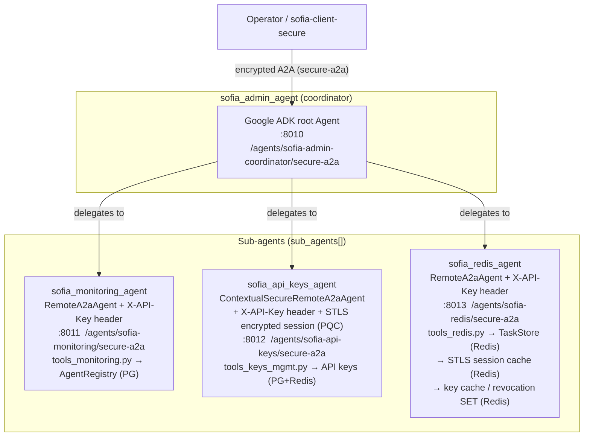

# Sofia Admin — Multi-Agent Administration Example

A Google ADK **coordinator agent** that administers the Sofia Platform by
delegating to three specialized **sub-agents**, each exposed as its own
independent STLS-A2A service. The example demonstrates agent-to-agent
orchestration over A2A, with two different transport-security postures
depending on how sensitive each sub-agent's domain is.

---

## The four agents

| Agent | Role | Port (local) | A2A endpoint |
|---|---|---|---|
| `sofia_admin_agent` (coordinator) | Routes operator requests to the right sub-agent(s) | `8010` | `/agents/sofia-admin-coordinator/secure-a2a` |
| `sofia_monitoring_agent` | Agent/platform health: liveness, capabilities, framework breakdown | `8011` | `/agents/sofia-monitoring/secure-a2a` |
| `sofia_api_keys_agent` | API key lifecycle: create, revoke, update scopes, usage stats | `8012` | `/agents/sofia-api-keys/secure-a2a` |
| `sofia_redis_agent` | Redis internals: A2A task store, STLS session cache, API key cache, revocation set | `8013` | `/agents/sofia-redis/secure-a2a` |

Each agent is its own process with its own `server.py`, `.env`, and
PostgreSQL-backed API key manager (`create_secure_a2a_endpoint` +
`ApiKeyManagerGroup`, from `stls_a2a`) — there is no shared state between
them other than the Postgres/Redis backends they each read from.

- `server/coordinator/` — `agent_coordinator.py` + `server.py`
- `server/monitoring/` — `agent_monitoring.py` + `tools_monitoring.py` + `server.py`
- `server/keys_management/` — `agent_keys_management.py` + `tools_keys_management.py` + `server.py`
- `server/redis/` — `agent_redis.py` + `tools_redis.py` + `server.py`

> The `identity_manager/`, `identity_bridge/`, `identity_trust_registry/`
> and `operator-b/` directories in this same sample folder belong to a
> **separate** identity-federation example and are not part of the
> coordinator/sub-agent flow described here.

---

## Architecture



---

## How the A2A interaction works

The coordinator is a plain Google ADK `Agent` whose `sub_agents=[...]` list
holds three **remote** A2A agents. At startup/first call, ADK fetches each
sub-agent's agent card from `{BASE_URL_*}/.well-known/agent-card.json`
(`AGENT_CARD_WELL_KNOWN_PATH`), learns its skills, and routes the LLM's tool
calls to it as standard A2A `messages/send` requests over HTTP. From the
coordinator's point of view, each sub-agent is just a URL plus a client:

```python
sofia_redis_agent = RemoteA2aAgent(
    agent_card=f"{BASE_URL_REDIS}{AGENT_CARD_WELL_KNOWN_PATH}",
    httpx_client=httpx.AsyncClient(headers={"X-API-Key": API_KEY_REDIS}, ...),
)

sofia_api_keys_agent = ContextualSecureRemoteA2aAgent(
    agent_card=f"{BASE_URL_API_KEYS}{AGENT_CARD_WELL_KNOWN_PATH}",
    extra_headers={"X-API-Key": API_KEY_API_KEYS},
    context_keys=[],
)
```

The system prompt in `agent_coordinator.py` gives the LLM explicit routing
hints ("which agents are running" → monitoring, "create/revoke keys" →
api-keys, "tasks"/"cache entries" → redis), plus a rule to coordinate both
`sofia_api_keys_agent` and `sofia_redis_agent` for cross-domain questions
such as "is the key for agent X still cached in Redis?".

### Two transport-security postures, by design

All three sub-agents sit behind `create_secure_a2a_endpoint`, so every call
is authenticated with a per-agent static `X-API-Key` (issued and checked via
each sub-agent's own `PostgresLoader` + `ApiKeyManager`). On top of that, the
**API-keys agent gets an extra layer**, because it is the one that creates,
reads and revokes the credentials every other agent relies on:

| | `sofia_monitoring_agent` / `sofia_redis_agent` | `sofia_api_keys_agent` |
|---|---|---|
| ADK wrapper | `RemoteA2aAgent` | `ContextualSecureRemoteA2aAgent` |
| Auth | `X-API-Key` header, plain `httpx.AsyncClient` | `X-API-Key` header **+** STLS encrypted session |
| Payload encryption | none (relies on transport/network security) | AES-256-GCM over a PQC-derived session key (hybrid X25519 + ML-KEM-768 by default), transparent to the ADK |
| Session/user context propagation | n/a | supported via `context_keys` (disabled here — `context_keys=[]` — since this sample has no per-user session state to forward) |

This mirrors the general STLS-A2A security layering: `create_secure_a2a_endpoint`
on the server side always requires API-key authorization, while the
`SecureA2ATransport` / PQC handshake is the additional encrypted channel used
wherever the payload itself — not just the caller's identity — needs
protection in transit.

### End-to-end call flow

1. An operator (human, or `sofia-client-secure`) sends a message to the
   coordinator's `/agents/sofia-admin-coordinator/secure-a2a` endpoint.
2. The coordinator's LLM decides, from the routing hints, which sub-agent(s)
   the request needs.
3. For each selected sub-agent, ADK issues an A2A `messages/send` call to
   that agent's own `secure-a2a` endpoint, carrying the sub-agent's
   `X-API-Key` (and, for `sofia_api_keys_agent`, an STLS-encrypted payload).
4. The sub-agent's `SecureA2AHTTPMiddleware` authenticates the key, decrypts
   the payload where applicable, and dispatches to its own ADK `Agent` and
   tools (`tools_monitoring.py`, `tools_keys_management.py`, `tools_redis.py`).
5. The sub-agent's tool reads/writes its backing store (Postgres for agent
   registry/API keys, Redis for task store/session cache/key cache) and
   returns a completed A2A `Task` with its result as an artifact.
6. The coordinator aggregates the sub-agent response(s) into its own reply
   to the operator. For cross-domain questions it repeats steps 2–5 against
   more than one sub-agent before answering.

---

## Running locally

Start the three sub-agents first (any order), then the coordinator — each
reads its peer's URL from its own `.env`:

```bash
# from each directory, in any order
cd server/monitoring      && python3 server.py   # :8011
cd server/keys_management && python3 server.py   # :8012
cd server/redis           && python3 server.py   # :8013

# last — it resolves BASE_URL_MONITORING / BASE_URL_API_KEYS / BASE_URL_REDIS
cd server/coordinator     && python3 server.py   # :8010
```

Each `.env` already points `BASE_URL_*` at `localhost:801{1,2,3}` for local
development; set `API_KEY_REDIS` / `API_KEY_API_KEYS` / `API_KEY_MONITORING`
in `server/coordinator/.env` to API keys issued by each sub-agent's own
Postgres-backed key store.

---

## Testing through sofia-client-secure

This example can be exercised end-to-end from
[`samples/client/sofia-client-secure`](../../client/sofia-client-secure) — a
React + Express chat client built specifically for agents that expose
encrypted transport. To point it at this coordinator:

1. Start `sofia-client-secure` (Python secure-transport service, Express
   backend, React dev server — see its own README).
2. Register the coordinator in `sf_agents_config`:

   ```sql
   INSERT INTO sf_agents_config (agent_name, url, api_key)
   VALUES ('sofia-admin', 'http://localhost:8010/agents/sofia-admin-coordinator/secure-a2a', '<coordinator API key>');
   ```

3. Grant a user access to it via `sf_agents_access` (optionally with a
   `profile` JSON payload).
4. Chat with `sofia-admin` from the UI — every message is routed through
   the coordinator exactly as described above, and the client's "secure"
   proxy path is what lets you drive `sofia_api_keys_agent`'s PQC-encrypted
   leg of the conversation without any special handling on the frontend.

---

## Deploying to Cloud Run

[`deploy/gcp`](deploy/gcp) provisions the **three sub-agents** on Cloud Run
(Cloud SQL Postgres, Memorystore Redis, Artifact Registry, Secret Manager) —
see its own README for the full Terraform layout. The coordinator is not
part of that Terraform module; it is meant to run wherever the operator
client lives (locally, or as a separate deployment you add yourself),
resolving `BASE_URL_MONITORING` / `BASE_URL_API_KEYS` / `BASE_URL_REDIS` to
the Cloud Run URLs of the three deployed services.
