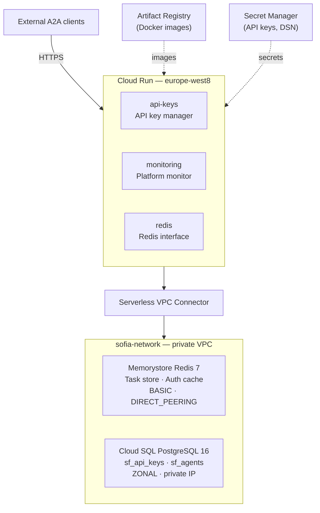

# Sofia Deploy — Terraform Infrastructure on GCP

Full deployment of the three STLS-A2A agents on **Cloud Run** with:
- **Cloud SQL PostgreSQL 16** (private IP, no public IP)
- **Memorystore Redis 7** (direct VPC peering)
- **Artifact Registry** (Docker images)
- **Secret Manager** (credentials and API keys)
- **Dedicated VPC** with Serverless VPC Connector

`BASE_URL` is automatically resolved at runtime by each server via
the GCP metadata server — no manual configuration needed.

---

## Structure

```
sofia-deploy/                          ← this repo (infrastructure)
├── docker/
│   ├── server-api-keys/
│   │   └── Dockerfile                 ← build context: server-api-keys/
│   ├── server-monitoring/
│   │   └── Dockerfile                 ← build context: server-monitoring/
│   └── server-redis/
│       └── Dockerfile                 ← build context: server-redis/
├── scripts/
│   ├── build-push.sh                  ← Build & push the 3 images
│   └── init-db.sql                    ← Initial PostgreSQL schema
├── terraform/
│   ├── main.tf                        ← Provider, GCP API enablement, locals
│   ├── variables.tf                   ← All variables with defaults and validations
│   ├── outputs.tf                     ← Infrastructure summary output
│   ├── vpc.tf                         ← VPC, subnet, private services access, connector
│   ├── iam.tf                         ← Service account, IAM bindings
│   ├── secrets.tf                     ← Secret Manager (DSN, Redis URL, API key)
│   ├── artifact_registry.tf           ← Docker registry with automatic cleanup
│   ├── cloudsql.tf                    ← PostgreSQL 16 on private IP
│   ├── redis.tf                       ← Memorystore Redis 7
│   └── cloudrun.tf                    ← 3 Cloud Run services via for_each
├── .gitignore
├── terraform.tfvars.example
└── README.md
```

### Expected structure in the application repo

Each server has its own standalone directory with `wheels/`, `requirements.txt`
and the `app/` folder containing all the sources copied into the container (in practice these match the docker ones)

```
<repo-root>/
├── server-api-keys/                   ← build context Dockerfile api-keys
│   ├── wheels/
│   │   └── stls_a2a-X.Y.Z-py3-none-any.whl
│   ├── requirements.txt
│   └── app/                           ← everything that ends up in /app inside the container
│       ├── server.py
│       ├── agent_keys_management/
│       │   └── __init__.py
│       └── ...other modules/files
│
├── server-monitoring/                 ← build context Dockerfile monitoring
│   ├── wheels/
│   │   └── stls_a2a-X.Y.Z-py3-none-any.whl
│   ├── requirements.txt
│   └── app/
│       ├── server.py
│       ├── agent_monitoring/
│       └── ...
│
└── server-redis/                      ← build context Dockerfile redis
    ├── wheels/
    │   └── stls_a2a-X.Y.Z-py3-none-any.whl
    ├── requirements.txt
    └── app/
        ├── server.py
        ├── agent_redis/
        └── ...
```

> **Wheel**: each server has its own copy in `wheels/`. If you prefer
> a single source, you can use a symlink or copy it with a pre-build script.

---

## Prerequisites

```bash
terraform --version   # >= 1.7
gcloud --version
docker --version

gcloud auth login
gcloud auth application-default login
gcloud config set project aichemy-dev-01
```

---

## Deploy — Step by step

### 1. Variable configuration

```bash
cp terraform.tfvars.example terraform/terraform.tfvars
# Edit terraform.tfvars with real values
```

### 2. Infrastructure provisioning

```bash
cd terraform
terraform init
terraform plan
terraform apply
```

At the end, the output shows the Redis IP, Cloud SQL IP, and Cloud Run URL.

### 3. PostgreSQL schema initialization

Connect to the private IP (e.g. from Cloud Shell in the same VPC):

```bash
DB_IP=$(terraform -chdir=terraform output -raw db_private_ip)

psql "host=${DB_IP} dbname=sofia user=spk_sofia password=<PWD>" \
     -f scripts/init-db.sql
```

### 4. Updating server.py

Copy `server.py` (and all modules needed for the server implementation) into the
`app/` folder of each server in the application repo:


### 5. Build & push Docker images

```bash
chmod +x scripts/build-push.sh
./scripts/build-push.sh 1.0.0
```

The script for each agent:
- Uses the **specific Dockerfile** `docker/server-{name}/Dockerfile`
- Sets the server directory (`server-{name}/`) as the **build context**
- Verifies that `wheels/`, `app/`, and the stls_a2a wheel are present
- Doesn't copy or move files — everything is already in the application repo's structure

### 6. Deploy services

```bash
cd terraform
terraform apply -var='default_image_tag=1.0.0'
```

The services start up and `BASE_URL` is automatically resolved
from the GCP metadata server — no second apply needed.

### 7. Deleting services via terraform

#### 1. Disable Cloud SQL deletion protection
cd terraform
terraform apply -var='db_deletion_protection=false'

#### 2. Empty the registry (required if it contains images)
gcloud artifacts docker images delete \
  europe-west8-docker.pkg.dev/aichemy-dev-01/sofia/server-api-keys \
  --delete-tags --quiet

gcloud artifacts docker images delete \
  europe-west8-docker.pkg.dev/aichemy-dev-01/sofia/server-monitoring \
  --delete-tags --quiet

gcloud artifacts docker images delete \
  europe-west8-docker.pkg.dev/aichemy-dev-01/sofia/server-redis \
  --delete-tags --quiet

#### 3. Destroy everything
terraform destroy

### 8. Suspending services

#### 1. Memorystore Redis
terraform destroy -target='google_redis_instance.sofia'

terraform apply -target='google_redis_instance.sofia'

#### 2. CloudSQL
gcloud sql instances patch sofia-pg \
  --activation-policy=NEVER

gcloud sql instances patch sofia-pg \
  --activation-policy=ALWAYS 

#### 3. Reactivating services (watch out for the Redis IP change)

##### 1. Recreate Redis
terraform apply -target='google_redis_instance.sofia'

##### 2. Update the secret with the new IP
NEW_IP=$(terraform output -raw redis_host)
echo -n "redis://${NEW_IP}:6379" | \
  gcloud secrets versions add sofia-redis-url --data-file=-

##### 3. Restart Cloud SQL
gcloud sql instances patch sofia-pg --activation-policy=ALWAYS

##### 4. Force the 3 Cloud Run services to restart to reread the secret
for svc in sofia-api-keys sofia-monitoring sofia-redis; do
  gcloud run services update $svc \
    --region=europe-west8 \
    --update-env-vars _RESTART=$(date +%s)
done

---

## BASE_URL — automatic resolution

Each `server.py` contains `_resolve_base_url()`, which checks in order:

1. Environment variable `BASE_URL` (explicit override, useful locally)
2. GCP metadata server `metadata.google.internal` (Cloud Run in production)
3. Fallback `http://localhost:{PORT}` (local development without GCP)

The Agent Card is generated with the correct URL with no additional configuration.

---

## Main variables

| Variable | Default | Description |
|---|---|---|
| `project_id` | — | GCP Project ID |
| `region` | `europe-west8` | GCP region (Milan) |
| `db_tier` | `db-g1-small` | Cloud SQL tier (`db-f1-micro` for dev) |
| `db_availability_type` | `ZONAL` | `ZONAL` or `REGIONAL` (HA) |
| `redis_tier` | `BASIC` | `BASIC` or `STANDARD_HA` |
| `min_instances` | `0` | Scale-to-zero. Use `1` to eliminate cold start |
| `max_instances` | `5` | Instance limit per service |
| `cloud_run_invoker_public` | `false` | `true` = public endpoints without GCP auth |
| `default_image_tag` | `latest` | Docker tag for all services |
| `image_tags` | `{}` | Per-service tag override |

---

## Main outputs

```bash
terraform -chdir=terraform output summary         # full summary
terraform -chdir=terraform output service_urls    # Cloud Run URL
terraform -chdir=terraform output db_private_ip   # Cloud SQL IP
terraform -chdir=terraform output redis_host      # Redis IP
```

---

## Updating services

```bash
# Build new version
./scripts/build-push.sh 1.1.0

# Deploy
cd terraform && terraform apply -var='default_image_tag=1.1.0'
```

To update a single agent:

```hcl
# terraform.tfvars
image_tags = {
  api-keys = "1.1.0"
  # monitoring and redis stay on default_image_tag
}
```

---

## Secret rotation

```bash
# Example OPENAI_API_KEY rotation
echo -n "sk-proj-NEW_KEY" | \
  gcloud secrets versions add sofia-openai-api-key --data-file=-

# Force a new deploy to reread the secret
gcloud run services update sofia-api-keys \
  --region europe-west8 \
  --update-env-vars _FORCE_REDEPLOY=$(date +%s)
```

---

## Security notes

- **PostgreSQL and Redis** have no public IPs — reachable only via the private VPC
- **KEY_PROVIDER_NAME=base** — no JVM in the container, lightweight images
- **Secret Manager** — credentials never pass through the Dockerfile
- **`db_deletion_protection = true`** — protection against accidental deletion
- **Non-root user** (`appuser`, UID 1001) in all containers
- Set `cloud_run_invoker_public = false` to require native GCP auth

---

## GCP Architecture


