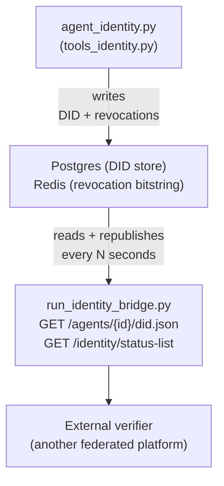

# Identity Bridge — README

HTTP server that publicly exposes two things on behalf of this
platform's Governing Authority: the **DID Documents** of its agents
and the revocation **status list**. It's the piece that lets an
external verifier (another federated platform) check an identity
**without ever having to contact the agent or the Authority directly**
in real time — it only reads these two public endpoints.

File: `run_identity_bridge.py` — independent of `agent_identity.py`
(its own configuration, its own process). Both import `stls_identity`
as an external dependency; neither lives inside the package.

## ✅ Verification status

The signatures of `create_identity_bridge_router()`,
`StatusListManager.publish()` and `StatusListCredential` assumed by
this file have since been confirmed against the real
`stls_identity` source (`stls_id_bridge.py`, `stls_id_status.py`,
`stls_id_models.py`) — all three exist with matching names.

## Why two separate processes (bridge + agent)

`agent_identity.py` is conversational, meant for a human operator
asking "create an identity for agent X". `run_identity_bridge.py` is
an HTTP server that needs to stay up at all times, serve external
requests, and keep itself refreshed — two different lifecycles, two
different processes, each with its own `.env`.

## Architecture at a glance



The bridge never writes anything — it reads what the agent has
already written (DID Document via Postgres, revocation state via
Redis) and republishes it in a public/cacheable format.

## The periodic task — why it exists

`IdentityManager.revoke()` only updates **the bit on Redis**. It
doesn't publish anything externally on its own — these are two
deliberately separate steps (revoking is instant and local,
publishing is a network operation towards a shared cache). If nobody
ever calls `StatusListManager.publish()` and writes the result into
the Postgres cache, `/identity/status-list` responds with:

```json
{"detail":"status list not published yet — refresher task has not run"}
```

`run_identity_bridge.py` solves this with a background task, started
at `startup`:

1. **Publishes once immediately** — otherwise the error above
   persists until the timer's first tick
2. Then every `STATUS_LIST_REFRESH_INTERVAL_SECONDS` (default 60s)

The interval **must stay below the MRI** (Maximum Revocation
Interval, 5 minutes / 300s in `verifier.py`'s code) — an external
verifier rejects a credential if the status-list snapshot it has
cached is older than the MRI. Publishing every 60s leaves ample
margin.

## Configuration — `.env.identity_bridge`

Copy `.env.identity_bridge.example` to `.env.identity_bridge` and fill
it in. Critical variables to keep **consistent with the agent's
`.env`**:

| Variable | Must match | Why |
|---|---|---|
| `IDENTITY_AUTHORITY_ID` | same var in the agent's `.env` | it's the bitstring that `IdentityManager.revoke()` updates — if different, the bridge publishes the revocation state of the wrong Authority |
| `STATUS_LIST_PUBLISH_URL` | same var in the agent's `.env` | goes into every issued `CredentialStatus.statusListCredential` — if different, it points to a URL this bridge doesn't serve |
| `IDENTITY_PG_DSN` / `IDENTITY_PG_DID_TABLE` | same vars in the agent's `.env` | the bridge reads the DID Documents the agent has written — different tables = empty bridge |
| `STATUS_LIST_REDIS_URL` | same var in the agent's `.env` | same bitstring, same Redis |
| `IDENTITY_KEYSTORE_BACKEND` / `IDENTITY_KEYSTORE_REDIS_URL` / `IDENTITY_KEYSTORE_REDIS_NAMESPACE` | same vars in the agent's `.env` | the bridge resolves (never regenerates) the Authority's key to publish its DID Document — different values = a different key than the one the Authority actually signs with |

All other variables are documented inline in
`.env.identity_bridge.example`.

## Startup

```bash
pip install fastapi uvicorn python-dotenv redis stls-identity
python3 run_identity_bridge.py
# or, with reload for development:
uvicorn run_identity_bridge:app --reload --port 8000
```

On startup, in order:
1. Creates the Postgres tables if they don't exist (`CREATE TABLE IF NOT EXISTS`, no manual migration)
2. Publishes the status list once
3. Starts the periodic task

## Exposed endpoints

| Endpoint | What it returns |
|---|---|
| `GET /agents/{agent_id}/did.json` | The agent's DID Document, if published (written by `bootstrap_agent_identity`) |
| `GET /identity/status-list` | The current `StatusListCredential` — compressed bitstring, who is revoked |

## Testing the component

See `test_identity_bridge_live.py` — a standalone script, not pytest,
meant to be run manually against an already-running bridge
(`python3 run_identity_bridge.py` in another terminal).

```bash
python3 test_identity_bridge_live.py
```

Covers, in sequence, against real HTTP:
1. Bootstrap + issue an identity (via `tools_identity.py`, not via HTTP — the agent writes, the bridge only reads)
2. `GET /agents/{id}/did.json` — must respond with the document just created
3. `GET /identity/status-list` — must respond (no longer the "not published yet" error, thanks to the immediate publish at startup)
4. Revoke the credential
5. Wait for a refresh cycle (`STATUS_LIST_REFRESH_INTERVAL_SECONDS` + margin)
6. Re-read `/identity/status-list` — the bitstring must reflect the revocation

## Troubleshooting

**`{"detail":"authority DID Document not bootstrapped yet"}`**
`GET /.well-known/did.json` — fixed: until recently this process never
published the Authority's own DID Document (only agents', via
`agent_id`). Now it does so on its own at `startup`
(`agent_path_segments=[]`, self-referential `controller` — different
from any regular agent's DID Document). If you still see this after
updating the file, check that `IDENTITY_KEYSTORE_BACKEND` and the
other keystore variables in `.env.identity_bridge` match exactly with
`.env.identity_agent` (see table above) — otherwise
`bootstrap_signing_key()` here generates/resolves a different key,
and the `put()` to Postgres can fail silently for other connection
reasons.

**`{"detail":"status list not published yet — refresher task has not run"}`**
The bridge never managed to publish. Check the startup logs: if
Redis or Postgres are unreachable, `_publish_once()` fails silently
in the periodic task (logged as an exception, doesn't crash the
process) — check `IDENTITY_PG_DSN` and `STATUS_LIST_REDIS_URL`.

**`GET /agents/{id}/did.json` returns 404 even after bootstrapping**
Verify that `IDENTITY_PG_DSN`/`IDENTITY_PG_DID_TABLE` in the bridge's
`.env` point to the **same** database/table as the agent's — this is
the most likely configuration mistake with two separate `.env` files.

**The revocation isn't reflected in `/identity/status-list` for a while**
Expected, not a bug: the bridge publishes it on the refresher's
**next** cycle, not instantly. The maximum delay is
`STATUS_LIST_REFRESH_INTERVAL_SECONDS`.
