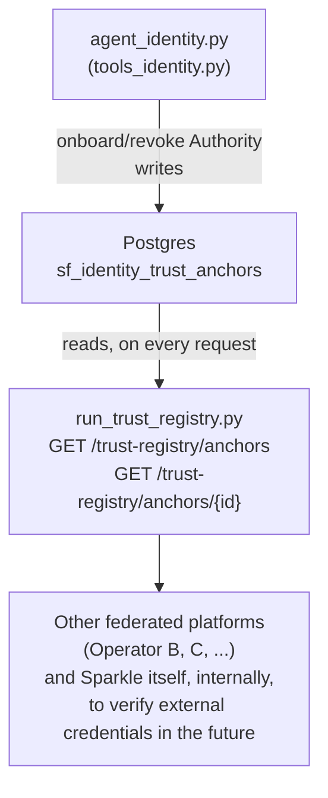

# Trust Anchor Registry — README

HTTP server that publicly exposes **which Governing Authorities are
recognized by the federation** and their current keys. Sparkle plays
the role of **anchor operator** (Option A from the original design: a
centralized registry, operated by an anchor member) — it's the piece
that lets another platform (Operator B, C, ...) know whether a third
platform is legitimate, without having to negotiate trust bilaterally
with each one.

File: `run_trust_registry.py` — independent of both
`agent_identity.py` and `run_identity_bridge.py` (its own
configuration, its own process). It only imports `stls_identity`'s
public API and isn't part of it.

## ✅ Verification status

`create_trust_registry_router()` is confirmed to genuinely work — the
router builds, FastAPI mounts it, and it exposes real endpoints
(verified via `/docs`, the interactive documentation FastAPI
generates automatically). The only initial mistake was in the
assumed **paths** (I had guessed `/trust-anchors`, the real ones are
underneath, with a `/trust-registry/` prefix) — corrected after direct
verification against `/openapi.json`, not from memory.

## Why three separate processes, not two

`agent_identity.py` is conversational — an operator asks "register
Operator B as a recognized Authority". `run_identity_bridge.py`
serves identities *internal* to Sparkle towards the outside. This
third process serves something conceptually different: not "who are
our agents", but "who do we trust as a federation" — the same
separation principle used for the bridge, applied to a different
domain (federation governance, not operational identity).

## Why it's simpler than the identity bridge

The identity bridge needs a periodic task because the status list is
a compressed bitstring that must be recomputed and republished. Here
there's nothing to compress: every request reads Postgres directly.
No refresher, no interval to tune against the MRI — just direct
reads.

## Architecture at a glance



This process is read-only — it never writes. Writing (onboard/revoke)
remains exclusively in the agent.

## Configuration — `.env.trust_registry`

Copy `.env.trust_registry.example` to `.env.trust_registry` and fill
it in. Critical variable to keep **consistent with the agent's
`.env`**:

| Variable | Must match | Why |
|---|---|---|
| `TRUST_REGISTRY_PG_TABLE` | same var in `.env.identity_agent` | it's the table that `onboard_trust_anchor`/`revoke_trust_anchor` write to — if different, this server publishes an empty or wrong registry |
| `IDENTITY_PG_DSN` | same var in `.env.identity_agent` | same "sofia" database |

## Startup

```bash
pip install fastapi uvicorn python-dotenv stls-identity
python3 run_trust_registry.py
# or, with reload for development:
uvicorn run_trust_registry:app --reload --port 8100
```

Default port **8100** — different from the bridge's (8000): they are
two distinct HTTP services, both exposed externally.

On startup: creates the table if it doesn't exist
(`CREATE TABLE IF NOT EXISTS`, same self-bootstrap as the other two
processes, no manual migration).

## Exposed endpoints (confirmed via `/docs`)

| Endpoint | What it returns |
|---|---|
| `GET /trust-registry/anchors` | List of currently recognized Authorities (current key generation, not revoked) |
| `GET /trust-registry/anchors/{authority_id}` | A specific Authority — 404 if unknown or revoked |

## How an Authority is onboarded, in practice

Not through this process — only through `agent_identity.py`
(`onboard_trust_anchor`), conversationally. The four fields are
copied **exactly** from the DID Document the other platform publishes
on its own bridge:

```
"Register Operator B as a recognized Authority:
 - authority_id: operatore-b
 - did: did:web:b.example.com
 - verification_method_id: did:web:b.example.com#key-1
 - public_key_multibase: z6Mk..."
```

No automatic network call to fetch this data — onboarding is a
deliberate administrative action (Option A: it's Sparkle, as anchor
operator, who decides who joins the federation), not an automatic
process that trusts whatever DID Document it happens to find.

## What it does NOT do (deliberately, for now)

**It does not verify credentials issued by an external Authority.**
This registry only says "what key does Operator B currently have" —
not "this specific credential issued by Operator B is still valid".
For that you'd also need to contact *that platform's* bridge for its
status list (their equivalent `run_identity_bridge.py`), a separate
piece, to be built when actually needed, building on this registry as
a first step (key resolution) but not stopping there.

## Testing the component

There isn't yet a dedicated live test script (unlike the identity
bridge, which has `test_identity_bridge_live.py`) — since this
process is read-only and simpler, the most direct way for now is: onboard
an Authority via `agent_identity.py`, then check with `curl`:

```bash
curl http://localhost:8100/trust-registry/anchors
curl http://localhost:8100/trust-registry/anchors/operatore-b
```

and manually verify that the content matches what was passed to
`onboard_trust_anchor`. If you want, I can write the automated
equivalent of `test_identity_bridge_live.py` for this component.

## Troubleshooting

**`GET /trust-registry/anchors` responds empty even after onboarding**
Verify that `TRUST_REGISTRY_PG_TABLE` in `.env.trust_registry`
matches exactly the one in `.env.identity_agent` — this is the most
likely configuration mistake with two separate `.env` files, the same
pattern of problem already seen with the identity bridge.

**`GET /trust-registry/anchors/{authority_id}` responds 404 for a just-onboarded Authority**
Check that you passed the exact same `authority_id` (case-sensitive)
used in `onboard_trust_anchor` — it's a short id, not the DID.

**A revoked Authority still shows up**
`revoke_trust_anchor` closes *all* key generations
(`revoke_authority`, not `revoke_key`) — if it still shows up, verify
you called `revoke_trust_anchor` with the correct `authority_id`, and
not — by mistake — `verification_method_id` or `did`.
